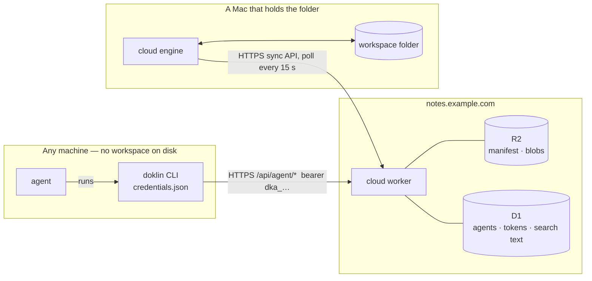

# Agents — a workspace from anywhere

> **Status: plan. Nothing in this document is built.** It is the design and
> the build order for making a connected workspace usable by an agent that
> does not have the folder on its disk.
>
> **Delete this file once the build is done.** It is a working plan, not
> documentation. What is worth keeping moves into [cloud.md](cloud.md) and
> the worker's README as each phase lands (§14); the last phase removes this
> file.

An agent — a bot on a remote computer, a coding agent in a sandbox — works
with a Doklin workspace through one command-line tool, `doklin`, that talks
to the workspace's own domain. It reads and writes documents, comments on
them, searches them and publishes them. It never syncs a copy of the folder,
and it never sees the files Doklin keeps beside a document.

Read [cloud.md](cloud.md) first: §3 (the rules), §5 (the worker), §6.6 (the
manifest) and §8.1 (people) are what this sits on.

## 1. The short version

- **A stateless CLI against the domain.** `doklin` holds a credential and
  nothing else. Every command is one or two HTTPS requests to
  `https://<domain>/api/agent/…`. There is no local copy, no sync and no
  background process on the agent's machine.
- **The worker gets a document API.** Reads, writes, moves, comments, search
  and publishing are worker operations. The worker changes the manifest
  itself, by the same etag compare-and-swap every Mac's engine uses, so a Mac
  sees an agent's change on its next poll and applies it like an edit from
  another Mac. The engine needs no new sync code.
- **A document, not files.** The API's noun is the *document*: one name, up
  to two versions (markdown and html) and its comments. The sidecar
  (`<stem>.meta.jsonl`) never appears.
- **An agent is its own identity.** The owner adds an agent in the app,
  picks what it may do, and gets one line to hand over:
  `doklin login https://notes.example.com dkla-…`. That is the only way in.
- **Permissions are the worker's.** An agent's token works on the document
  API only, and only within what the owner ticked. There are no rate limits
  of Doklin's own in this build; Cloudflare usage is watched instead (§11.3).
- **Only a connected workspace is reachable.** A folder with no domain has
  nothing for a remote agent to reach.

## 2. Vocabulary

- **Agent** — an identity on a domain that is not a person: a name and a set
  of permissions. Created and removed by the owner. Its id is `a-` and
  eight hex characters, and it signs what it changes exactly as a member id
  does (cloud.md §6.6).
- **Login code** — a one-time, expiring code the owner's app mints for an
  agent (`dkla-XXXXX-XXXXX-XXXXX-XXXXX`, 100 bits). Traded once for a token.
- **Agent token** — the credential a login leaves on one machine
  (`dka_` + 64 hex). Stored by the worker as its sha256.
- **Document** — a name in a folder with one or two **versions**:
  `plan.md`, `plan.html`, or both. Plus its comments.
- **Plain file** — anything else in the workspace: an image, a PDF, a CSV.
  No versions, no comments.
- **Document API** — the routes under `/api/agent/`. The only routes an
  agent token is accepted on.

## 3. The rules

1. **An agent never gets the sync API.** `/api/manifest`, `/api/blobs`,
   `/api/versions`, `/api/poll`, `/api/auth` and `/api/admin` answer an agent
   token with 403. A token that could `PUT /api/manifest` could rewrite the
   whole workspace, and no permission would mean anything.
2. **The worker is the only thing that knows a document is several files.**
   The CLI never names a sidecar, never pairs `.md` with `.html` itself, and
   never builds a manifest.
3. **A document changes atomically.** A move, a delete or a new comment
   touches up to three files; they land in one manifest write or not at all.
4. **No silent overwrite.** Replacing content needs the revision the agent
   read, or an explicit `--force`.
5. **Disk is still the truth on a Mac.** An agent's write is a remote change
   like any other: the engine merges it, and overlapping edits become a
   conflict copy (cloud.md §6.5). Nothing here weakens that.
6. **The CLI is thin.** Anything that needs Doklin's own rules — pairs,
   comment markers, the public map — runs in the worker, which already
   bundles the app's pure modules (`criticMarkup.ts`, `metaFile.ts`).
7. **One way to log in.** `doklin login <domain> <code>`. No environment
   variables, no token pasted by hand, no second path.

## 4. Architecture



The worker becomes one more writer of the manifest, coordinated by the etag
CAS that already coordinates the Macs. Cloud.md's rule 2 ("the engine is the
only writer") is a rule about a Mac — no frontend code speaks to the worker —
and stays true.

## 5. Documents

### 5.1 One document, up to two versions

The app already treats `plan.md` and `plan.html` in one folder as one
document (`list_md_tree` folds the html into the markdown's row; a move
carries both and the sidecar). The document API makes that the only view:

- **markdown** — the source. People write and review it in Doklin.
- **html** — an optional designed page, usually made by an agent from the
  markdown. When it exists, the public page shows it first.

They share one name, one set of comments and one public address. Changing
the markdown leaves the html describing an older text. The API says so:
`ls`, `info` and the answer to a markdown write carry `html: behind` when the
html's `mtime` is older than the markdown's. No new state is stored for it.

A document may have **only** an html version. That is already true today —
an html file with no markdown beside it carries its own sidecar and is
publishable on its own (`cloud-worker/src/pages.ts`). It is a full document:
it lists, reads, moves, publishes, takes comments and is searched.

### 5.2 Naming a document

A document is named by its path without an extension: `Projects/plan`.
`Projects/plan.md` and `Projects/plan.html` name the same document and also
pick a version. `--md` and `--html` pick one explicitly.

| The document has | `read`, `edit` with no flag | `--md` | `--html` | `write` with no flag |
| --- | --- | --- | --- | --- |
| markdown only | markdown | markdown | refused: "no html version — `write --html` creates one" | markdown |
| markdown and html | markdown | markdown | html | markdown |
| html only | html | refused: "html only — `write --md` adds a markdown version" | html | **refused**: "html only — say `--html` to replace it or `--md` to add markdown" |
| nothing yet | not found | — | — | creates markdown; `--html` creates an html-only document |

- Every answer names the version it acted on.
- `write` is the one command that refuses to guess on an html-only document:
  a default there would let markdown text replace an html page by accident.
- `mv`, `rm` without a version flag, `publish` and `comments` act on the
  whole document whatever extension was typed.
- `rm --html` or `rm --md` removes one version. The last version cannot be
  removed that way; `rm` removes the document. Removing the markdown removes
  the comment threads anchored in it.
- Markdown means any of `.md`, `.markdown`, `.mdown`, `.mkd`. Two markdown
  files with one stem in one folder are ambiguous; the API asks for the full
  name.

### 5.3 What the API hides and refuses

- `*.meta.jsonl` is never listed, read or written.
- A path with a hidden segment (`.something`) or one of the names the sync
  ignores (`node_modules`, `target`, `dist`, `build`, `__pycache__`) is
  refused: a Mac's scan would never see the file (`is_hidden_or_ignored`).
- A name that collides case-insensitively with an existing one is a 409 —
  the workspace lives on a case-insensitive disk.

### 5.4 The public entry follows the document

A public entry references one file id. The rule: **a document's entry points
at its markdown file when it has one, otherwise at its html file.** The
document API keeps it true whenever a version is added or removed, so an
html-only page that gains a markdown version gains the MD/HTML pill.

A deleted document's entry stays (cloud.md §9, decision 7): the page answers
404 until the document is back or someone stops publishing. `rm` says so in
its answer.

## 6. The CLI

One binary, `doklin`, for Linux (x64, arm64) and macOS (arm64), attached to
every release and installed by one line:

```sh
curl -fsSL https://github.com/boat-builder/doklin/releases/latest/download/install-doklin.sh | sh
```

It is a Rust crate of its own (`cli/`): no runtime to install on a bot's
machine, and the release pipeline already builds Rust.

### 6.1 Commands

| Command | What it does | Permission |
| --- | --- | --- |
| `login <domain> <code>` | trade the code for this machine's token | — |
| `logout` | forget the token here and revoke it on the domain | — |
| `whoami` | workspace, agent, permissions | read |
| `ls [folder] [--deep]` | folders, documents (with their versions, `html: behind`, public addresses) and plain files | read |
| `info <doc>` | versions with revision, size, who changed it and when; comment count; public addresses | read |
| `read <doc> [--md\|--html] [--clean] [-o file]` | the content and its revision. `--clean` drops comment markers | read |
| `search <text> [--in folder] [--limit n]` | documents containing the text, with line numbers and the matching lines | read |
| `comments <doc>` | every thread: the text it is on, who said what, whether its anchor is gone | read |
| `comment <doc> --on "<text>" -m "<body>"` | start a thread on that text | comment |
| `reply <doc> <thread> -m "<body>"` | answer a thread | comment |
| `comment rm <doc> <thread>` | remove a thread | comment |
| `write <doc> [--md\|--html] [--if-rev n\|--force]` | create or replace a version, from stdin or `--from file` | edit |
| `edit <doc> --find "<old>" --replace "<new>" [--all]` | change part of a version | edit |
| `mv <from> <to>` | move or rename a document, a plain file or a folder | edit |
| `rm <doc> [--md\|--html]` | remove a document, or one version | edit |
| `publish <doc or folder> [--slug s] [--title t] [--desc d]` | make it public; prints the address | publish |
| `unpublish <doc, folder or slug>` | stop publishing | publish |
| `published` | everything public: address, document, by whom, when, whether its file is gone | read |

Plain files use the same `read`, `write`, `mv` and `rm` with their full
name (`Projects/chart.png`), `-o` and `--from` for the bytes.

On macOS, an argument that is not a command is a path to open in the app —
what today's `doklin` shell shim does. The binary replaces the shim.

### 6.2 Behaviour

- **Output.** Text for a terminal, JSON when stdout is not one (or with
  `--json`). `read` writes the content to stdout and the metadata to stderr,
  so `doklin read plan > plan.md` is clean.
- **`--dry-run`** on every command that changes something. On `publish` of a
  folder it lists every document that would become public.
- **Exit codes.** `0` done · `2` bad usage · `3` not found · `4` not
  permitted · `5` conflict (the revision moved, or the name is taken) · `6`
  not logged in, or the token was revoked · `7` the worker is too old for
  this command.
- **Errors are sentences that name the next step.**
- **`edit`** is a read and a conditional write inside the CLI. `--find` must
  match exactly once unless `--all`.
- **Help is where the concepts live.** `doklin help documents` explains the
  two versions and why they must be kept in step; `help comments` explains
  the markers; `help publishing` what public means. `doklin help agent`
  prints a short brief an agent can read once.

### 6.3 The credentials file

`~/.config/doklin/credentials.json` (`$XDG_CONFIG_HOME` honoured), mode 0600
in a 0700 directory:

```json
{ "version": 1,
  "workspaces": [
    { "endpoint": "https://notes.example.com", "name": "Notes",
      "agent": "Grok bot", "token": "dka_…" } ] }
```

One entry per domain. With one entry every command uses it; with several,
`-w notes.example.com` picks. There is no keychain path: a bot's machine is
usually a headless Linux box with none, and one code path is the point.

## 7. Auth

### 7.1 Agent, code, token

The same three lifetimes as people (cloud.md §8.1), in three new D1 tables:

```sql
agents       (id, name, scopes, created_at, last_used_at, disabled)
agent_codes  (hash, id, agent_id, created_at, expires_at)   -- sha256(code)
agent_tokens (hash, id, agent_id, host, created_at)          -- sha256(token)
```

1. **The owner adds an agent** in the app: a name and permissions. The
   app mints a code, sends `sha256(code)` — the worker never sees the code
   until it is redeemed — and shows one line, once:
   `doklin login https://notes.example.com dkla-7QK2M-…`
2. **Whoever sets the bot up runs it** — a person in a shell, or the agent
   itself when the line is pasted into its chat. `POST /api/agent/login`
   (no bearer) deletes the code and mints the token.
3. **The code is single-use and lives an hour.** That is deliberate: the
   line will be pasted into chats, and a spent or expired code in a
   transcript is worth nothing. *New code…* in the app issues another — for
   a second machine, or after an expiry.
4. **Revoking** is deleting a row: one machine's token, or the agent and
   everything it holds. It takes effect on the next request.

An unknown code and an expired one answer the same 401. At 100 bits there is
nothing to throttle (cloud.md §5.4).

### 7.2 Permissions

| Permission | Lets the agent |
| --- | --- |
| `read` | list, read, search, read comments, see what is public |
| `comment` | start, answer and remove comment threads |
| `edit` | write, edit, move and remove documents and plain files |
| `publish` | publish and stop publishing |

- `publish` is off unless the owner ticks it. A remote agent cannot be
  asked to confirm in the app, so this box is the whole gate. The dialog
  says what it means: *can make any document in this workspace public*.
- `comment` without `edit` is a reviewer: it can say things about a text it
  cannot change.
- Setting the domain's home page stays in the app.
- Nothing an agent holds reaches people, invites, other agents, version
  history, the bind or the wipe (§3, rule 1).

### 7.3 How a request is authenticated

A bearer starting `dka_` is an agent's and is resolved by one primary-key
lookup, the way a member's token is:

```sql
SELECT a.id, a.name, a.scopes, a.last_used_at
  FROM agent_tokens t JOIN agents a ON a.id = t.agent_id
 WHERE t.hash = ? AND a.disabled = 0;
```

No row: 401. Otherwise the route's permission is checked against `scopes`.
One D1 read per request and no write: `last_used_at` is moved at most once
an hour, the way a member's `lastSeenAt` is (cloud.md §8.1), so the People
view can say when an agent was last here without a write on every request.

The owner's secret and members' tokens are untouched: the owner still
authenticates with no database read.

### 7.4 What the app and the engine gain

- **People view** (`CloudPeople.tsx`): an *Agents* section, owner only. Each
  agent with its permissions, the machines it is logged in on and when it
  was last used; *Add an agent…*, *New code…*, *Edit…*, *Remove*; a machine
  revocable on its own.
- **Engine commands** (owner): list, create, update, new code, remove,
  revoke a machine — thin wrappers over `/api/auth/agents…`, like the
  people commands beside them.
- **The directory.** `/api/meta`'s `people` lists agents too, so every Mac
  can put a name to an `a-` id. `manifest.rs`'s `is_member_id` becomes "is
  an id the directory can resolve" (**change both sides**). An app a release
  behind shows the raw id — legible, never wrong.

## 8. The document API

All under `/api/agent/`, bearer required except the login. JSON in and out,
except document bytes.

```
POST   /api/agent/login            NO BEARER — {code, host?} → 201 {token, agent, workspace}
DELETE /api/agent/login            this token revokes itself
GET    /api/agent/me               {agent, scopes, workspace, version, features}
GET    /api/agent/tree?dir=&deep=  folders, documents, plain files — from the manifest alone
GET    /api/agent/doc?path=&v=     the bytes; x-doklin-rev, x-doklin-version, x-doklin-html-behind
                                   &clean=1 strips comment markers · &info=1 answers metadata only
PUT    /api/agent/doc?path=&v=     the new bytes; if-rev: <n> | * (must not exist) | absent with &force=1
DELETE /api/agent/doc?path=[&v=]   the document, or one version
POST   /api/agent/move             {from, to}
GET · PUT · DELETE /api/agent/file?path=    a plain file
GET    /api/agent/comments?path=
POST   /api/agent/comments         {path, on, body} starts a thread · {path, thread, body} answers one
DELETE /api/agent/comments?path=&thread=
GET    /api/agent/search?q=&dir=&limit=
GET    /api/agent/pages            the public map, as addresses
PUT    /api/agent/pages            {path, slug?, title?, desc?, dryRun?} → {slug, url, documents}
DELETE /api/agent/pages?slug= | ?path=
```

Owner-only, beside the people routes:

```
POST   /api/auth/agents                    {name, scopes, codeHash, expiresAt} → 201 {agent}
GET    /api/auth/agents                    every agent: its machines, pending code, last used
POST   /api/auth/agents/<id>               {name?, scopes?}
POST   /api/auth/agents/<id>/code          {codeHash, expiresAt} — replaces a pending one
DELETE /api/auth/agents/<id>               the agent and every token it holds
DELETE /api/auth/agents/<id>/tokens/<tid>  one machine
```

### 8.1 The commit

Every change runs through one function, `commit(env, mutate)`:

1. put any new blobs (`blobs/<fileId>/<hash16>`, immutable — a retry is free);
2. read the manifest and its etag;
3. apply `mutate` — which also re-checks the caller's precondition (`if-rev`)
   against the manifest it was just handed;
4. `validateManifest` — the same check a Mac's PUT goes through;
5. put with `onlyIf: {etagMatches}`; on a lost race go back to 2, four times.

What `mutate` must keep, because the engine reads it (`engine.rs`,
`apply_remote`):

- a new file gets a fresh id (`f-…`), `rev: 1`; a changed one `rev + 1`, the
  new `hash`, `size` and `mtime`; `by` is the agent's id; `seq + 1` always;
- a move changes `path` only — the engine renames in place when the hash is
  unchanged;
- a delete removes the entry and leaves a tombstone `{path, rev + 1, ts, by}`
  — a Mac moves its clean copy to the Trash;
- a move re-points the public map in the same commit: file entries keep
  their id and take the new `path` snapshot; a folder entry follows a moved
  folder.

A lost race on step 5 is another device's unrelated write far more often
than a real conflict, which is why the precondition is the file's `rev`,
checked inside `mutate`, and not the etag.

### 8.2 What a Mac sees

Nothing new. Its next poll finds a new etag and runs a cycle: a download, a
rename, a merge with what was typed there in the meantime, a conflict copy
when they overlap. An agent's deletion lands in that Mac's Trash and in
*Recently deleted* ([versioning.md](versioning.md)). The version store is
what undoes an agent's mistake; the CLI has no history of its own.

### 8.3 Skew

`/api/agent/me` answers the worker's version and features. Each phase adds a
feature name (§14); a command whose feature is missing exits 7 with
"update the worker on notes.example.com". The CLI sends
`x-doklin-client: cli/<version>`.

## 9. Comments

Comments stay where they are on disk: a marker in the markdown
(`{==text==}{>>#id<<}`), the conversation in the sidecar (`mthread`), and
html threads wholly in the sidecar (`hthread`). The API speaks threads.

- **`comments`** answers every thread on the document, both versions: id,
  which version, the anchored text (and its line, for markdown), each entry's
  author, time and body, and `orphaned` when the anchor no longer resolves.
- **A new thread on markdown.** `--on` must occur exactly once in the text
  and not inside an existing marker; otherwise the answer lists where it
  occurs. The worker wraps it, adds the `mthread` record and commits both
  files together. The author is the agent's name.
- **A new thread on html.** An html thread anchors to an element
  (`htmlComments.ts`). `--on` is the opening words of one — a heading, a
  paragraph, a list item. The worker walks the markup with a small tolerant
  tokenizer, finds the innermost element whose text starts with those words,
  and stores `{path: "", tag, text}`: the app already falls back to tag and
  leading text when a path does not resolve (`htmlBridge.ts`,
  `resolveAnchor`). No match, or more than one: refused, with the candidates.
- **`reply`** and **`comment rm`** change the sidecar; removing a markdown
  thread also unwraps its marker.
- **`read` keeps the markers** so read-then-write keeps comments attached.
  After any markdown write the worker compares the marker ids before and
  after. A thread whose marker went is kept as an orphan, as the app keeps
  it, and the answer names it. A marker with an id no thread has is refused
  — an agent may not invent one.

## 10. Search

The same question the app's own search asks: *which documents contain this
text*, case-insensitively, with the lines.

- **A text mirror in D1.** One row per document: `(fid, hash, folded)`, where
  `folded` is the lower-cased text — the markdown with markers stripped, or
  an html-only document's text with tags stripped — followed by its comment
  bodies. Keyed by file id, so a move or a rename costs the index nothing.
- **Kept by the worker, lazily.** A document the API writes is mirrored in
  the same request. Changes Macs make are caught up when the manifest's etag
  has moved past the one the mirror last saw: stale rows are found by
  comparing `(fid, hash)` with the manifest, and re-read twenty at a time.
  A search that finds more than that still stale answers `202` with what is
  left, and the CLI asks again until it is whole. After a Mac's manifest PUT
  the worker also catches up a batch in `waitUntil`, so the mirror usually
  is.
- **The query** is `instr(folded, ?) > 0`, restricted to a folder when asked,
  capped at `limit` documents (20). The matching lines are cut from the
  blobs of those documents.
- **Out of the mirror:** a text over 1 MB (D1 caps a row at 2 MB) is listed
  as not searchable rather than silently missed.
- It is derived data: a wipe empties it, and a D1 outage costs search and
  nothing else.

Ranked full-text search (SQLite FTS5, which D1 carries) can replace the scan
behind the same command if workspaces outgrow it. The scan reads one row per
document per search, which is the whole of its cost (§11.2).

## 11. Limits and budgets

### 11.1 What Cloudflare limits

Figures from Cloudflare's limits and pricing pages, read 2026-11-13.

| Limit | Free plan | Resets | When it is passed |
| --- | --- | --- | --- |
| Worker requests | 100,000 a day | 00:00 UTC | every request to the domain answers error 1027 until the reset: sync, public pages and agents alike |
| Worker CPU | 10 ms a request | — | that request fails |
| Subrequests | 50 a request | — | that request fails |
| D1 rows read | 5 million a day | 00:00 UTC | D1 queries fail: people, presence, leases, agents and search stop; sync and public pages carry on |
| D1 rows written | 100,000 a day | 00:00 UTC | the same |
| D1 size | 500 MB a database, 5 GB in all | — | writes fail until something is deleted |
| R2 storage | 10 GB | monthly | billed past it, $0.015 a GB-month |
| R2 Class A (put, list) | 1 million a month | monthly | billed, $4.50 a million |
| R2 Class B (get, head) | 10 million a month | monthly | billed, $0.36 a million |

- **There is no per-minute and no per-hour limit**, and no monthly limit on
  requests. The daily ones are hard stops; R2's monthly ones are not —
  the pricing page lists a price past the free amounts and does not say
  usage is blocked (to confirm on a real account).
- **A subrequest** is each call the worker makes while answering one
  request: an R2 read or write, a D1 query, an outbound fetch. Fifty is a
  cap on how much one request may do, not a quota that runs down. An agent
  command uses three to eight. It shapes two things here: the search
  catch-up works twenty documents at a time, and no command does unbounded
  work in one request.

**The paid plan** is $5 a month for the whole Cloudflare account, and it
turns every daily stop into a monthly allowance with a price past it:

| | Included a month | Past it |
| --- | --- | --- |
| Worker requests | 10 million | $0.30 a million |
| Worker CPU | 30 million ms; 30 s a request by default | $0.02 a million ms |
| Subrequests | 10,000 a request | — |
| D1 rows read | 25 billion | $0.001 a million |
| D1 rows written | 50 million | $1.00 a million |
| D1 storage | 5 GB; 10 GB a database | $0.75 a GB-month |
| R2 | the same free amounts | the same prices |

Ten million requests a month is about 333,000 a day with no daily cut-off. A
domain that somehow served 30 million in a month would pay $5 + $6.

### 11.2 What an agent costs

| | Worker requests | D1 rows written | R2 Class A | R2 Class B |
| --- | --- | --- | --- | --- |
| a read (`ls`, `info`, `read`, `comments`, `published`) | 1 | 0 | 0 | 1–3 |
| a search | 1 | 0 (one a document being caught up) | 0 | 1 + up to 20 |
| a write (`write`, `mv`, `rm`, a comment, `publish`) | 1 **+ about 2 for every Mac online** | 1 | 2–4 | 1–3, + 2 a Mac |
| `edit` | a read and a write | | | |

The row that matters is the write's fan-out. A write moves the manifest's
etag, and every Mac that is running sees it within fifteen seconds and runs
a cycle — a manifest GET and a blob GET (cloud.md §11.3). **An agent's write
costs the domain about `1 + 2 × Macs online` requests**: five for one person
with two Macs, twenty-one for a team of ten with the app open.

Worker requests a day is the binding number, as it is for sync
(cloud.md §11.2). Everything else an agent uses stays in single-digit
percentages of its free allowance.

### 11.3 No limits of Doklin's own — usage is watched instead

**Decided 2026-11-13: this build adds no per-minute, per-hour or per-day
limit on an agent.** It keeps the scope small, and nobody yet knows what real
agents cost. The exposure is known and accepted for now: Cloudflare has no
rate limit to lean on, so an agent stuck in a loop can spend the free plan's
100,000 requests, and the domain then errors until 00:00 UTC. The owner's
remedy in the meantime is removing the agent, which takes effect on its next
request.

What is watched, for the first days and weeks agents are in use:

| What | Against | How it is read |
| --- | --- | --- |
| D1 rows read and written, last 24 h | 5 million and 100,000 a day | `wrangler d1 info <database> --json` |
| The costliest D1 queries | — | `wrangler d1 insights <database> --time-period 7d --sort-by writes` |
| R2 storage and object count | 10 GB | `wrangler r2 bucket info <bucket> --json` |
| **Worker requests a day** | 100,000 a day | Cloudflare's GraphQL Analytics API, `workersInvocationsAdaptive` |
| R2 Class A and B operations | 1 million and 10 million a month | the same API, `r2OperationsAdaptiveGroups` |
| What one agent is doing right now | — | `wrangler tail <worker> --format json` |

- **Wrangler has no command for the number that matters most.** Worker
  requests a day, and R2's operation counts, come only from the dashboard or
  the Analytics API (`https://api.cloudflare.com/client/v4/graphql`, a bearer
  token, up to a month of data). `wrangler auth token` prints the token
  wrangler is logged in with; whether its permissions reach Workers
  analytics is **not verified** — if they do not, one read-only API token
  with *Account Analytics: Read* does.
- **The worker counts nothing itself.** No usage columns, no counters: the
  point of the decision is to add nothing.
- **A small script, not a feature.** `scripts/cloud-usage.sh <domain>` runs
  the reads above and prints one table against the free plan's numbers. It
  is for us, during the watch; it ships nowhere.

**What brings limits back.** Any of: a day's Worker requests passing about
70,000 with agents in use; an agent seen looping; D1 rows written passing
half its allowance. The design is ready when that happens — a per-agent
budget (requests a minute, requests a day, writes a day) counted in the
statement that authenticates the token, so it costs no extra query — and it
is a change to the worker and the People view alone.

### 11.4 What to measure before trusting it

- **CPU.** A write parses and re-serialises the manifest. On a 5,000-file
  workspace that may pass 10 ms on the free plan. Measure in phase 2; the
  fallback is to name the paid plan in the error.
- **The fan-out.** §11.2's "about two requests a Mac for every write" is
  cloud.md §11.3's arithmetic, not a measurement of agents. The watch is
  where it gets one.
- **R2 past its free amounts** — billed or blocked — on a real account.

## 12. Decisions, and what was rejected

1. **CLI first; an MCP server later, on the same API.** Every agent with a
   shell can run a CLI, it costs an agent no context until it is used, and
   the document API is the reusable part. Rejected for now: a remote MCP
   server in the worker (it needs OAuth, and nothing is lost by adding it
   after).
2. **The worker changes the manifest; the CLI does not speak the sync
   protocol.** Rejected: a CLI that fetches the manifest, uploads a blob and
   PUTs the manifest back. It needs no worker change, but any token that may
   do it may rewrite everything, each write downloads the manifest, and the
   document rules would live in a third place.
3. **No sync client for agents.** Rejected: a headless engine on the bot's
   machine. It is a full replica with merge state, conflict copies and a
   process to keep alive, to serve a client that wants one document.
4. **One way to log in: a one-time code.** Rejected: a token pasted by hand
   or set in an environment variable (a second path, and a durable secret in
   a chat transcript); a keychain (absent on the machines bots run on).
5. **An agent is not a member.** A member is a person keyed by an email;
   an agent has none, and has permissions a member does not.
   Rejected: a `members` row with a made-up address.
6. **Four permissions, enforced by route.** Rejected for the first cut: a
   permission per folder. The API is path-based, so it is a check to add,
   not a redesign.
7. **Publishing is gated by a permission, not by a prompt.** The app may not
   be running when a remote agent publishes.
8. **`write` refuses to guess on an html-only document; reads resolve.**
9. **Markers stay in what `read` returns.** Rejected: clean text by default
   with anchors repaired on write — repairing anchors by guessing is the
   problem the hybrid layout exists to avoid.
10. **Search is a substring scan over a D1 mirror.** It matches the app's
    search exactly and has no moving parts. FTS5 is the upgrade, not the
    start.
11. **No rate limits in this build; measure first** (§11.3). Deferred, not
    rejected: a per-agent budget counted in the authenticating statement.
    Rejected for when it comes: Cloudflare's rate-limit binding (a new
    binding in every `wrangler.toml`, counters per location, periods of 10
    or 60 seconds only — no daily budget).
12. **No history, boards, presence or sync controls in the CLI.** A card is
    a markdown document and reads and writes as one.

## 13. Verifying it

- **Worker** — `node cloud-worker/test/run.mjs`: agents end to end (create,
  code, login, one-time and expiring codes, revoke), the gate (an agent
  token on every sync route answers 403), each permission, the commit under
  a racing manifest PUT, the version table of
  §5.2 case by case, pairs moving and deleting whole, the public entry
  following a document, comments on both versions, the search mirror
  catching up.
- **Engine** — `cargo test --lib cloud`: a manifest written the way §8.1
  writes it (create, change, move, delete, a pair, a sidecar) applied by the
  two-device matrix, including against a local edit.
- **CLI** — `verify-harness/drive-cli.mjs`: the built binary against
  `serve-worker.mjs`, every command, every exit code.
- **By hand** — a bot on another machine, a Mac with the folder open:
  edit from the bot while typing on the Mac; publish from the bot and open
  the address; comment from the bot and answer in the app.

## 14. Build order

One phase per branch and pull request; each is releasable on its own, bumps
`WORKER_VERSION` and adds a feature name (cloud.md §5.7).

1. **Agents and login** — feature `agents`. The D1 step, `/api/auth/agents…`,
   `/api/agent/login` and `/me`; the engine commands and the People view's
   Agents section; the CLI with `login`, `logout`, `whoami`; the release
   assets and install script; `scripts/cloud-usage.sh` for the watch (§11.3).
   *Done when* an agent added in the app logs in from another machine, sees
   its permissions, is refused on the sync API, and stops working the moment
   it is removed.
2. **Documents** — feature `agent-docs`. The commit, tree, doc, file and
   move routes; the directory resolving `a-` ids; `ls`, `info`, `read`,
   `write`, `edit`, `mv`, `rm` and the help topics.
   *Done when* every row of §5.2 behaves as written, a pair moves whole, a
   Mac shows the agent's name on what it changed, and a write over a stale
   revision is refused.
3. **Publishing** — feature `agent-pages`. The pages routes; `publish`,
   `unpublish`, `published`.
   *Done when* an agent without `publish` is refused, a published address
   answers at once, and the app's Published list names the agent.
4. **Comments** — feature `agent-comments`. Threads on markdown, then on
   html.
   *Done when* a thread started from the CLI opens in the app's rail on both
   versions, a reply made in the app reads back from the CLI, and a write
   that drops a marker reports the orphan.
5. **Search** — feature `agent-search`. The mirror, the catch-up, `search`.
   *Done when* the CLI and the app's search agree on a seeded workspace, and
   an edit made on a Mac is found from the CLI after the next sync.

**As each phase lands**, what it built is written into the documents that
stay — [cloud.md](cloud.md) (the worker's routes and tables, the engine's
commands, the People view, the decisions of §12) and
[cloud-worker/README.md](../cloud-worker/README.md) (the wire contract) —
and the CLI's own help carries what a user of it needs.

**The last phase deletes this file**, along with any link to it. Nothing
that is true once the build is done should exist only here.
