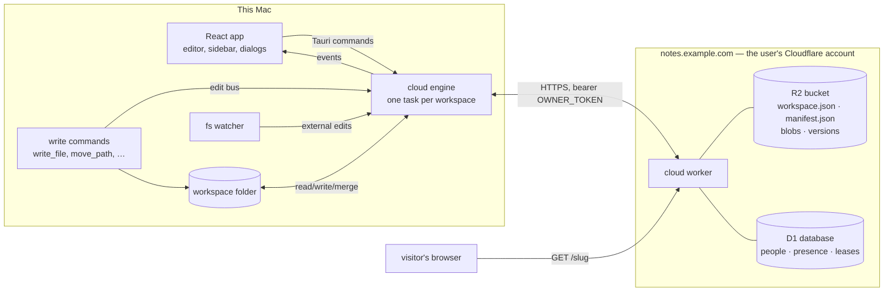
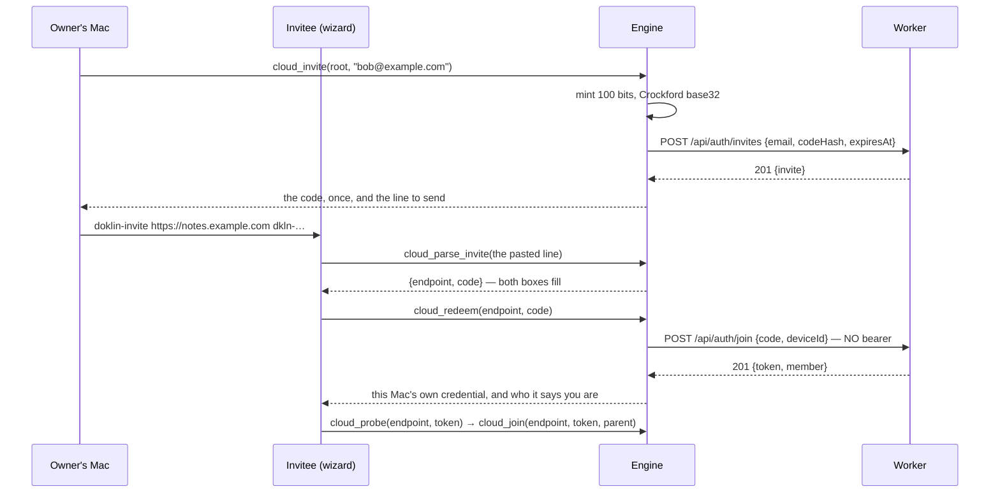

# Cloud — one domain per workspace

A workspace (the folder Doklin opens) connects to a domain of the user's own
— a Cloudflare Worker in front of an R2 bucket, on the user's account, set
up by an agent from a prompt the app writes. Connected means the whole
folder is backed up and kept in sync on every Mac that holds it, with
per-file history; publishing a note or a folder is one flag in the synced
manifest, and the worker renders the public page from the synced files on
request. This document is how it is built: the vocabulary, the invariants,
the worker, the engine, the app's surfaces, the people a workspace is shared
with and the leases that keep two of them out of one document, and the
decisions behind each. The wire contract on its own is
[cloud-worker/README.md](../cloud-worker/README.md); how to verify any of it
is `.claude/skills/verify/SKILL.md`.

## 1. The short version

- A **workspace** connects to exactly **one domain**, and a domain holds
  exactly **one workspace**. The binding is recorded in the cloud (the
  worker refuses a second workspace) and on disk (a hidden marker in the
  folder). Connecting means: the whole folder is backed up and kept in sync,
  on every machine that holds it.
- **One writer.** A single Rust engine per workspace owns every byte that
  goes to or comes from the cloud. It is fed by the app's own writes (an
  in-process edit bus), by the filesystem watcher (external tools), and by a
  poll. The frontend never speaks HTTP; it sends the engine commands and
  listens to its events.
- **Publishing is a flag, not a push.** Every file is already in the cloud,
  so "publish this page" is one record in the workspace manifest: *slug →
  file*. The worker renders public pages straight from the synced files —
  markdown, boards, properties, table widths, html renditions — with the
  same pure modules the desktop uses. Nothing is re-pushed, fingerprinted,
  or reconciled; a public page is exactly as fresh as the sync.
- **Public only.** A public page is a read-only page on your domain, with
  `noindex`, that says what the file says. There are no access codes, no
  roles, no web editor and no web comments.
- **Agent + wrangler is the only setup route.** The app mints the owner
  token, writes the prompt, the agent runs wrangler, one `ENDPOINT:` line
  comes back, the app verifies and connects. Tearing it down is another
  prompt. Updating the worker is neither — the sequence is fixed, so it is
  a script the app hands you two commands for (§7.4).

---

## 2. Vocabulary

- **Workspace** — the folder Doklin opens (the sidebar's root). The unit of
  sync and of publishing. Drafts are not in a workspace.
- **Domain** — a hostname (`notes.example.com`, or a `workers.dev` address)
  serving one Cloudflare Worker in front of one R2 bucket. Called "domain"
  in the UI even when it is a subdomain. In this codebase "backend" means
  the Tauri (Rust) side of the app and nothing else.
- **Connected** — a workspace that has a domain. Connected ⇒ backed up and
  in sync. Not connected ⇒ purely local; nothing can be published.
- **Device** — one installation of Doklin (`cloud.json` mints an id and
  takes the Mac's name on first run). Several devices can hold one
  workspace.
- **Engine** — the Rust task that syncs one workspace with its domain.
- **Manifest** — the one mutable object in the bucket: every file's path,
  revision and content hash, plus the **public map**.
- **Public page** — an entry in the public map: a slug, and the file or
  folder it exposes at `https://<domain>/<slug>`.
- **Owner token** — the secret the app generates at setup and the worker
  holds as its `OWNER_TOKEN` secret. The only credential that exists today;
  invites (later, §8.1) mint per-person tokens beside it.

---

## 3. The rules

These are the invariants the code is built to keep. If a change breaks one,
the change is wrong.

1. **One domain ⇄ one workspace.** The worker's `workspace.json` is created
   with create-only semantics; a second create answers 409 and the app
   offers *join* (pull the existing workspace), never a second binding. The
   folder's hidden marker records the same pair.
2. **The engine is the only writer.** No frontend code holds the token after
   setup, no frontend code calls the worker. Publishing, history, wipe, the
   version probe — all engine commands.
3. **The manifest is the only truth about what is public.** The frontend's
   view of the public map is the engine's status event, nothing else. No
   `localStorage` registry.
4. **A public page is a rendering of synced files.** The worker never stores
   page content of its own; it reads blobs. Therefore a page can never be
   staler than the sync, and never fresher.
5. **Disk is the source of truth for content.** The engine merges, never
   clobbers; overlapping edits become a conflict copy beside the file;
   deletions go to the Trash.
6. **The API only grows; an old worker fails legibly.** One version integer,
   parsed from the worker's source at build time, probed behind auth; a
   too-old worker turns into an "update the worker" state, not an error.
7. **No accounts, no dashboard, no terminal for the user.** The app writes
   the prompt; an agent runs wrangler; the app verifies.

---

## 4. Architecture at a glance



Three parties, two contracts:

- **Engine ⇄ worker**: the sync API (manifest CAS, blobs, the version store, the poll and the presence and leases it carries)
  plus three small admin routes (meta, bind, wipe). JSON over HTTPS, bearer
  auth. Written down in [cloud-worker/README.md](../cloud-worker/README.md).
- **UI ⇄ engine**: Tauri commands in, events out. Typed in one file
  (`src/cloud.ts`), mirrored by serde structs in Rust
  (`src-tauri/src/cloud/status.rs`).

The visitor's contract is just URLs (§5.3).

---

## 5. The cloud side — `cloud-worker/`

The worker is TypeScript (it imports the app's own pure modules, and vite
bundles it anyway), flattened by `scripts/bundle-worker.mjs` into one
readable file that people are asked to trust-deploy, and attached to every
release at

```
https://github.com/boat-builder/doklin/releases/latest/download/doklin-cloud-worker.js
```

### 5.1 Resources and names

One domain = one worker + one bucket + one D1 database + one secret, all
named from the domain so two setups can never collide:

| Domain | Worker | Bucket | Database | Endpoint |
| --- | --- | --- | --- | --- |
| `notes.example.com` (a zone on the same account) | `doklin-notes-example-com` | `doklin-notes-example-com` | `doklin-notes-example-com` | `https://notes.example.com` |
| free `workers.dev`, chosen name `sherin-notes` | `doklin-sherin-notes` | `doklin-sherin-notes` | `doklin-sherin-notes` | `https://doklin-sherin-notes.<account>.workers.dev` (the agent reports it) |

Secret: `OWNER_TOKEN` (32 random bytes, hex; the app mints it). R2 binding:
`DATA`; D1 binding: `DB`. `wrangler.toml` is written verbatim into the
prompt (§7.4); `cloud-worker/wrangler.toml.example` is the same file for
doing it by hand. The naming rule is one function, `resourceName` in
`src/cloudPrompts.ts`.

The database is where people, presence and leases live — everything a blob
store cannot hold: a `UNIQUE` email, a credential deleted atomically, a row
per device upserted without a lost update, a lock acquired in one statement:

```sql
meta     (key, schema_version)                   the migration runner's anchor
members  (id, email UNIQUE, name, role, created_at, last_seen_at, disabled)
tokens   (hash, id, member_id, device_id, device_name, created_at)
invites  (hash, id, member_id, created_at, expires_at)
presence (device_id, member_id, device_name, path, ts)    a row per Mac here now (§5.3's poll)
leases   (path, device_id, member_id, device_name, until) a row per document open somewhere (§8.2)
```

Two columns carry a name beside an id — `tokens.device_name`, and the Mac's
name on `presence` and `leases` — so authenticating and answering a poll each
stay single-row lookups rather than joins. `member_id` is nullable on the
last two: an owner who never adopted an identity is here, and holds
documents, as their Mac. The database is single-primary: D1's read replicas
(the Sessions API) trade strong consistency for locality, and a lease that
two Macs might both believe they hold is worse than none.

The worker builds and migrates that schema itself
(`cloud-worker/src/schema.ts`): an update ships one bundled file and no
migrations directory, so `wrangler d1 migrations apply` is not available to
a domain being updated. An ordered list of steps runs on the `/api/meta`
probe, at most once per isolate, with idempotent `CREATE TABLE IF NOT
EXISTS` statements and a guarded `UPDATE meta SET schema_version = <to>
WHERE schema_version = <to-1>`, so two isolates reaching a fresh database
converge instead of colliding.

A domain deployed before the binding existed has no `DB` at all, and the
whole sync API works exactly as it did — `/api/meta` answers `"d1": null`.
What it cannot do is resolve a member's token or answer an identity route,
because those *are* the database. The owner's own credential never reads a
row (§5.4), so losing D1 costs a workspace its people, never its owner.

### 5.2 R2 layout

```
workspace.json              {id, name, createdAt, createdBy: {deviceId, deviceName}}
                            — the binding. Written once, create-only.
manifest.json               the workspace manifest (v3, §6.6) — CAS by etag
blobs/<fileId>/<hash>       immutable file content, addressed by (a prefix of) its sha256
versions/index.json         {version, horizonDays, snapshots: [{id, ts, device, reason, files,
                            bytes, digest, pinned?, label?, restoredFrom?}]} — CAS by etag
versions/snapshots/<id>.json.gz   one whole workspace state, gzip'd; immutable.
                            <id> is <ts13>-<deviceId> — when it was taken and by whom
versions/blobs/<hash>       one file's content, gzip'd; immutable, keyed by its FULL sha256
```

Nothing public is stored here: public pages are *rendered* from `blobs/`.
And nobody is stored here: people, their tokens and their invites are rows
in the D1 database beside the bucket (§5.1), because a blob store cannot
hold a `UNIQUE` email or delete a credential atomically. Neither is who is
here: presence was `presence.json` until worker v7, one object every device
read, changed and wrote back with no CAS — a lost update whenever two beats
crossed, and an R2 write per beat (§11.2). It is a row per device now. A
bucket an older worker wrote may still hold that object, or `history/`
archives from before v6; nothing reads either, and a wipe takes both.
The layout and the grammar of its ids live in `cloud-worker/src/layout.ts`.

`versions/` is the cloud half of versioning ([versioning.md](versioning.md)
§6.4) and shares nothing with the sync side: its own prefix, its own index,
its own content addresses (the whole sha256, where a synced blob is named by
a 16-character prefix). It mirrors what every device keeps locally, so the
history outlives the laptop that made it; a workspace that has never
mirrored simply has no `versions/index.json`.

### 5.3 API

All `/api/*` routes require `Authorization: Bearer <token>` and answer JSON.
The engine also sends `x-doklin-device: <deviceId>` (attribution: presence,
the binding's `createdBy`) and `x-doklin-client: <app version>` (for the
logs; nothing reads it). There is no CORS and no preflight — the engine is
the only caller.

```
GET    /api/meta                 {version, features, workspace: {id, name, createdAt, createdBy} | null,
                                 d1: <schema version> | null,
                                 you: {role, memberId, email, name}, people: [{id, name}]}
                                 — liveness, the credential, "is this domain bound", the state of the
                                 database, who you are and what everyone here is called, in one call;
                                 also where the schema migrates itself
POST   /api/workspace            owner; bind: body {name, deviceName?, ownerEmail?, ownerName?}
                                 → 201 {id, name, createdAt, createdBy, manifestEtag, owner?};
                                 409 {workspace} when already bound
GET    /api/workspace            {id, name, createdAt, createdBy, files, bytes}
GET    /api/poll                 {manifestEtag, presence: {<deviceId>: {memberId, name, path?, ts}},
                                 leases: [{path, deviceId, memberId, name, until}] | null}
                                 — the cheap 15 s poll; reads only
POST   /api/poll                 the same poll carrying this Mac's beat: body {name, path?, take?} —
                                 "here, editing path", which claims that document's lease (§8.2) —
                                 or {leave: true}; needs x-doklin-device to record it
GET    /api/manifest[?since=e]   the manifest + x-manifest-etag (304 when unchanged)
PUT    /api/manifest             header x-base-etag required (428 without); 412 + current etag
                                 on a lost race; 400 on garbage; 426 on ANY other schema version —
                                 the sentence names which side is behind; 413 past 4 MB
GET    /api/blobs/<fid>          {blobs: [{hash, size, uploaded}]} — the inventory GC diffs
GET    /api/blobs/<fid>/<hash>   the bytes (content-type as uploaded)
PUT    /api/blobs/<fid>/<hash>   store bytes (immutable: a re-PUT of a stored hash is a no-op,
                                 {existed: true}); 413 past 25 MB
DELETE /api/blobs/<fid>/<hash>   garbage-collect an unreferenced revision
GET    /api/versions/index       the version store's index + x-versions-etag; 404 when there is none
PUT    /api/versions/index       header x-base-etag required (428 without), "*" creates; 412 + etag
                                 on a lost race; 400 on garbage; 413 past 1 MB
GET    /api/versions/snapshots/<id>   the gzip'd workspace state; 404
PUT    /api/versions/snapshots/<id>   store it (immutable: a re-PUT is {existed: true}); 413 past 4 MB
DELETE /api/versions/snapshots/<id>   drop one the ladder thinned away
GET    /api/versions/blobs[?cursor=c] {blobs: [{hash, size, uploaded}], cursor?} — ONE page
GET    /api/versions/blobs/<hash>     the bytes
PUT    /api/versions/blobs/<hash>     store bytes (immutable, {existed: true} on a re-PUT); 413 past 25 MB
DELETE /api/versions/blobs/<hash>     collect a version no retained snapshot references
POST   /api/admin/wipe           owner; body {"confirm":"wipe"} — erase everything, batched;
                                 repeat until remaining:false. Frees the domain for a new binding.

POST   /api/auth/join            NO BEARER — {code, deviceId?, deviceName?} → 201
                                 {token, tokenId, member}; 401 when the code is unknown or
                                 expired, which answer identically
POST   /api/auth/invites         owner; {email, name?, codeHash, expiresAt} → 201 {invite};
                                 creates the member if the email is new, replaces their pending one
GET    /api/auth/invites         owner; the pending, unexpired ones
DELETE /api/auth/invites/<id>    owner; withdraw one (204)
GET    /api/auth/members         owner; everyone, with a device count and lastSeenAt
POST   /api/auth/members         owner; {email, name?} — adopt or rename the owner's own identity
DELETE /api/auth/members/<id>    owner; the person and every credential they hold (204)
GET    /api/auth/tokens          owner; {id, memberId, email, deviceName, createdAt} — never a hash
DELETE /api/auth/tokens/<id>     owner; revoke one device (204)
```

Everything under `/api/auth` is the D1 database beside the bucket; a
deployment that has none answers `503` there and loses nothing else.

`/api/meta`'s `you` and `people` are that database too, and they are on
`meta` rather than behind a route of their own for two reasons: every engine
already calls it before it writes anything, and `/api/auth` stays exactly
what it says — the owner's. `you.memberId` is the id this Mac's work is
signed with (null for an owner who has adopted no identity); `people` is ids
and display names, because a manifest names ids and every Mac has to be able
to put a name to one. Addresses, roles and device counts stay owner-only.

The three `/api/history/<fid>` routes that served the manifest's retired
per-file history are **gone** as of worker v6, with the `history/` prefix
they read ([versioning.md](versioning.md) §6.5, and §5.7's compatibility
rule). Nothing had written one since the version store landed; what kept
them was compatibility with a release nobody runs.

**The poll carries presence** (worker v7). The beat used to be a request of its own — `PUT /api/presence` every
other poll — and an R2 write each time; now the engine attaches it to the
poll it was going to make anyway, and the method says whether anything is
written: a `GET` only reads, and a `POST` upserts the caller's row (or, for a
leave, deletes it), sweeps rows past the 90 s TTL and answers with what is
left, in one D1 batch. The engine sends a `POST` only when a beat is due —
every 45 s, or the moment the edited path changes — so two polls in three
write nothing. Each entry names the Mac (`name`) and whose it is
(`memberId`; the owner's is the adopted row, null when there is none), and
the person's `lastSeenAt` moves with it, at most once an hour. Revoking a
Mac or removing a person deletes their row in the same batch, so neither
lingers in *Here now* for the TTL.

**…and leases** (worker v8). A beat that names a path also claims that
document: one upsert on `leases`, keyed by the path lowercased, that takes
the row when it is free, lapsed or already this Mac's — renewing it — and
changes nothing when somebody else holds it; `take: true` drops that last
condition, which is the whole of *Take over*. The same batch lets go of
anything else this Mac held, so a beat naming another document, or none,
releases, and a leave releases everything. The answer lists every live lease
beside presence. Nothing about a lease touches sync: §8.2 is the design.

Presence and leases are never on the sync path: with no database, a broken
one, or a D1 query that throws, the poll still answers the etag, with
`presence: {}` and `leases: null` — "the domain could not say", which every
editor reads as no lock. A beat it cannot attribute (no `x-doklin-device`)
or whose path is not one is a poll all the same — it answers, and records
what it can.

Not bound yet? `/api/poll` (either method — a beat to an empty domain
records nobody, and claims nothing), `/api/manifest` and `/api/workspace` answer
`404 {"error":"not bound"}`.

Public (no auth, `GET`/`HEAD` only; anything else is a 405):

```
GET /                          the root page when the map names one (and its file exists),
                               else the landing page (the workspace's name, "Download Doklin")
GET /<slug>                    a published note: its html rendition, framed, when the workspace
                               holds <stem>.html beside it; the markdown otherwise
GET /<slug>?v=md               the markdown rendering explicitly (the MD/HTML pill)
GET /<slug>/raw                the html rendition verbatim, under Content-Security-Policy: sandbox
GET /<dirSlug>                 a published folder: every note under it, as a table of contents
GET /<dirSlug>/<rel/path>      a note inside it (markdown extension dropped, segments
                               percent-encoded, case-insensitive), its rendition at …/raw, or an
                               image / PDF / html file by its exact path (anything else 404s)
GET /og.png · /<slug>/og.png   the site's static Open Graph image
GET /robots.txt · /favicon.ico · /apple-touch-icon.png
GET /__web/<tag>/mermaid.js    the standalone mermaid module (immutable, content-tagged)
GET /__web/fonts/<file>        the Newsreader files the app bundles (a week, like the icons)
everything else                a 404 page — an unpublished path, a slug whose file is gone
```

Every page carries `<meta name="robots" content="noindex">` and the
`x-robots-tag` header.

### 5.4 Auth

- `OWNER_TOKEN` is compared by SHA-256 in constant time against the worker's
  env secret, **with no database read**. The order is the design, not an
  optimization: a D1 outage degrades a workspace to one credential rather
  than locking its owner out of their own domain. Role `owner`.
- Only a bearer that is *not* the owner's costs a row read —
  `tokens.hash = sha256(bearer)`, joined to the member holding it: one
  primary-key lookup. Revoking is deleting that row, and it takes effect on
  that device's very next request; there is no session, so there is nothing
  to expire.
- **A token always authenticates as `member`**, whatever `members.role`
  says. That column describes a *person* — it is what the People list shows
  — and is never evidence of authority: owner comes from the env secret and
  from nowhere else, so no row anybody can write confers it. Inviting the
  owner's own address mints an ordinary member credential, which is right:
  their second Mac already has the real one.
- **A member is not a limited account.** `PUT /api/manifest` is not
  role-gated: any valid bearer rewrites the manifest wholesale, tombstones
  included. What a member cannot do is *administer* the domain — bind,
  wipe, invite, list people and revoke are owner-only. Identity buys
  attribution and per-person revocation, not read-only access and not
  per-folder scope.
- `POST /api/auth/join` is the one route above the gate, matched on method
  **and** path exactly, because answering it is how a Mac gets a bearer at
  all. Everything else under `/api/auth` is owner-only and inside it.
- Guessing is off the table rather than throttled: an invite code is 100
  bits of Crockford base32, so there is no attempt cap, no lockout and no
  counter to store. Entropy is free; a counter is not.
- Neither secret is ever stored in the clear: a token is its own sha256, an
  invite is `sha256(code)`, so the database is a list of people rather than
  a list of credentials. The plaintext code crosses the wire only at
  redeem, which is precisely what makes the stored hash useless to anyone
  who reads it.
- No cookies, no gate, no sessions, no rate limiter for visitors — there is
  nothing to unlock.

### 5.5 The binding

`POST /api/workspace` writes the empty manifest first and `workspace.json`
second, both with R2's create-only put (`onlyIf: {etagDoesNotMatch: "*"}`).
A bind that dies between its two writes therefore leaves a *free* domain
with an empty manifest for the next bind to adopt — never a bound domain
with no manifest. A second call gets `409 {workspace}`. That is the whole
cloud-side mapping: **a domain is bound iff `workspace.json` exists**, and
the only thing that removes it is `POST /api/admin/wipe`. `GET /api/meta`
reports the binding so the setup wizard can tell "fresh domain" from
"already holds *Notes*, created on Sherin's iMac" before doing anything.

### 5.6 Public rendering — from synced files

Six modules, each a question:

- **`workspace.ts` — what is in the synced tree.** `openWorkspace(env)` does
  one `head(manifest.json)` per request and fetches the body only when the
  etag moved past the isolate's memoized copy (the manifest is read
  tolerantly — an unknown field never breaks a page). A `Workspace` answers
  `fileAt(path)` (case-insensitively, like the disk the files live on),
  `file(fid)`, `noteAt(stem)`, `text(loc)` / `bytes(loc)` (a note over 4 MB
  is refused rather than rendered), `children(dir)` and `directNotes(dir)`
  (for tables of contents), `storeAt(dir)` (the folder's `store.jsonl` plus
  the first 16 KB of every card — one ranged get each, eight in flight — the
  way `read_store` reads it in the app) and `meta(stem)` (the
  `<stem>.meta.jsonl` sidecar).
- **`publicMap.ts` — where is this file public.** Which slug a file answers
  at, which folder page covers a path (deepest first), and `urlFor(path,
  prefer)`: inside the folder the page was reached through first, then the
  file's own slug, then the closest published folder. A note can be public
  two ways at once, on its own slug and inside a published folder; both
  answer, and the crumb on the nested one points at the folder.
- **`pages.ts` — a page from its files.** A note from its blob: comment
  markers stripped with the same `src/criticMarkup.ts` the desktop uses
  (bodies never leave the sidecar), the frontmatter split off with
  `src/store/frontmatter.ts` and shown as a properties table coloured by the
  folder's own `store.jsonl` (`rank` is never shown), each ` ```kanban ` /
  ` ```table ` fence found in the raw bytes (`storeFences`) and drawn from
  `storeAt(dir)` with `src/store/board.ts`'s `boardSnapshot` — the same
  derivation the tab and the embed use, so the three can't disagree —
  column widths from the sidecar under the app's own table identity
  (`tableSignature` + `deriveId`, pinned by both test suites), relative
  links rewritten (below), the html rendition framed by default and served
  verbatim at `…/raw` under `Content-Security-Policy: sandbox allow-scripts
  allow-popups`. A folder's table of contents (cards for a handful of notes,
  a collapsible tree past eight). Images, PDFs and html files inside a
  published folder by exact path, html and SVG sandboxed.
- **`render.ts` — the HTML.** `marked` with the app's own renderer
  overrides (`table` for the `<colgroup>`, `code` for boards and mermaid,
  `link` and `image` for the rewriting), the page chrome (`noindex`, the
  `og:*` and twitter meta, the MD/HTML pill, the "← Folder" crumb), the
  table-of-contents layouts, the mermaid hydrator (the diagram takes the
  page's palette in light and in dark, as in the app), and the stylesheet,
  inlined in every page. A board or table is drawn as the app's embed draws
  it — the bar naming its kind, the board's name over its progress ("1 of 3
  done") or its count, columns tinted in their hue with the stage glyph,
  cards with their excerpt (when the view shows them), pills and dates, a
  finished card checked — and a card with a page is a link over the whole
  card.
- **`theme.ts` — the app's look.** The page's tokens and type are not
  restated: the worker imports `src/styles/tokens.css` and
  `src/styles/fonts.css` as text, and the Newsreader files as bytes, when it
  is built. The theme-independent `:root`, the light palette and the dark
  palette are taken by selector — light as `:root`, dark under
  `prefers-color-scheme`, so a page reads right with scripts off — and
  paper and the document-font variants are left out (they are choices made
  inside the app; no browser can ask for them). The `@font-face` rules point
  at `/__web/fonts/`, and a page set in the serif preloads its latin face.
  A palette change in the app reaches published pages with the next worker
  build — and, like any change to what a page looks like, with a
  `WORKER_VERSION` bump, which is how a deployed domain learns to update.
- **`public.ts` — routing and the cache.** `caches.default` under the
  synthetic key `https://cache.doklin/<manifestEtag><pathname><search>`,
  filled with `ctx.waitUntil`; the cached copy is good for a day, the
  browser is told `no-cache`; 200s and 404s are cached alike, the static
  assets bypass. A manifest change gives every URL a new key, so a page is
  never served stale past one `head`; old entries age out. Steady state per
  public request: one `head`, one cache hit. `static.ts` holds the landing
  page, the 404 page (both in the same theme), robots, the icons, the OG
  image (`og.ts`), the fonts and the mermaid module.

| Input | Where it comes from |
| --- | --- |
| Markdown | the note's blob; comment markers stripped with `criticMarkup.ts` |
| Frontmatter → properties table | split off by the worker with `store/frontmatter.ts`, coloured by the card's own `store.jsonl` |
| Boards / tables in ` ```kanban ` / ` ```table ` fences | derived on request from `storeAt(dir)` with `store/board.ts` (`boardSnapshot`); a board changing shows on the next view |
| Table column widths | the synced `<stem>.meta.jsonl`, read with `metaFile.ts` |
| Html rendition | the sibling `<stem>.html` blob, when the manifest has one |
| Folder table of contents | `children(dir)`, grouped by subfolder |
| OG image | one static PNG in the worker; `og:title` / `og:description` carry the page's words |

The pure modules the worker bundles from `src/` — `store/frontmatter.ts`,
`store/storeFile.ts`, `store/board.ts`, `store/embedConfig.ts`,
`store/rank.ts`, `metaFile.ts`, `criticMarkup.ts`, `tableWidths.ts`,
`docLinks.ts` — are exactly the ones `verify-harness/store.test.mjs`,
`metafile.test.mjs`, `tablewidths.test.mjs` and `doclinks.test.mjs` pin.
Nothing that touches Tauri or React enters the worker.

**A board reads at most 40 cards** and says how many more it holds ("N more
cards aren't shown here"). A Worker on the free plan may make 50
subrequests per request; a 200-card board would fail outright instead of
rendering.

**Slugs and paths.** A slug is `^[a-z0-9][a-z0-9-]{2,63}$`, not in
`{api, __web, raw, og.png, robots.txt, favicon.ico, apple-touch-icon.png,
join}`. Nested paths under a folder slug resolve `dir.path + "/" + rest +
".md"` (any markdown extension, case-insensitively), then the exact path
for the non-markdown files the folder holds, which serve with their content
type. A subfolder of a published folder is not a page of its own (404); its
notes are.

**Links between notes.** A relative link (`[plan](./plan.md)`) resolves
against the note's own folder (`..` may not escape the workspace). A public
target is rewritten to its public URL — inside the folder the page was
reached through first, then the target's own slug, then the closest
published folder; an unpublished target is dropped to its plain text; a
relative image becomes `` when it is reachable the same way and its alt
text otherwise; other schemes, `#anchors` and absolute paths are left
alone. A board's card links follow the same rule: a card inside a published
folder links to its nested page, a card outside any public folder is a
title, not a dead link.

**The root.** `root: true` on one entry serves it at `/`. If that entry's
file is gone from the manifest, `/` falls back to the landing page rather
than 404ing the site; the entry stays in the map until stopped (§9,
decision 7).

### 5.7 Version, update, wipe

- `cloud-worker/src/version.ts` is the one place the version lives — a
  separate file so the app's build can read the integer without bundling
  the worker (§7.1): `WORKER_VERSION` (9 — the sync API was 1; publishing
  made it 2; the version store made it 3; the D1 binding made it 4; people
  made it 5; attribution by person made it 6; presence in D1, folded into
  the poll, made it 7; leases made it 8; public pages in the app's own look
  made it 9, with no API change), `WORKER_FEATURES`
  (`["sync", "wipe", "publish", "boards", "versions", "members", "presence",
  "leases"]`; a feature name is a promise about behaviour, listed only once
  the behaviour exists — the engine mirrors nothing to a worker that does
  not list `versions`, sends no beat to one that does not list `presence`,
  and owes no claim to one that does not list `leases`),
  `MANIFEST_VERSION` (3) and `COMPATIBILITY_DATE` (the Workers
  runtime date `wrangler.toml` pins; moving it changes every new deploy's
  runtime, so it is moved on purpose).
- **The compatibility rule.** No released app and no deployed worker has
  to keep working with the other side's next release — what they owe each
  other is narrower: a skewed pair **refuses politely and never corrupts**.
  Every change to the wire bumps `WORKER_VERSION`, so a pair that disagrees
  says so (the update badge, `worker-outdated`, a `426` naming which side is
  behind) instead of misbehaving. That rule is what let the `/api/history`
  routes, the manifest's `hist` and `presence.json` simply go rather than
  linger as dead routes, and what made `by` a member id outright, with no
  parallel field. What it does not buy is skipping the bumps: an app updated
  before its worker is a normal Tuesday, not a broken install.
- The engine probes `/api/meta` on start and on every poll and reports
  `workerVersion` in its status; the frontend compares with the bundled
  integer and shows the update badge. A worker that receives a manifest
  with a schema version it does not know answers `426`, which the engine
  reports as phase `worker-outdated` — the one case where sync pauses — and
  it resumes on its own the moment a newer version answers the probe.
- `POST /api/admin/wipe` is batched, owner-only, repeated until done; it is
  the erase step of teardown and the only way to free a domain. Its last
  round also empties the D1 tables and re-runs the schema, so a rebound
  domain inherits nobody from the old one.
- Version 4 carried no new behaviour of its own — it was the update badge
  doing its job, so the `DB` binding reached deployed domains before
  anything depended on it. Version 5 is what depends on it, and it adds the
  feature name `"members"`: a promise the app can act on, that this worker
  mints and resolves per-person tokens. A bare `d1` is still deliberately
  not a feature name — that is plumbing, and `/api/meta`'s `d1` reports it
  more precisely than a name in a list could.
- `"presence"` (version 7) is the promise that `POST /api/poll` takes a
  beat. Every worker has had presence of some kind; before 7 it was a route
  of its own, and the poll answered `GET` only. So an app that finds the
  name missing polls with `GET` and sends nothing — its Mac goes unseen, sync
  is untouched — and an app a release behind keeps polling with the `GET`
  that still answers, its own beats going to a route that is gone. Neither
  side corrupts anything; each is waiting on an update it is already being
  shown. While a worker lacks `versions`, `presence` or `leases` the engine
  asks `/api/meta` again hourly, so an update reaches Macs that are already
  running.
- `"leases"` (version 8) is the promise that a beat's path claims the
  document and that the poll says who holds what. A worker without it
  answers no `leases`, and the app opens every document as it always has.
  An app a release behind, on a worker with it, still beats with a path —
  so it holds leases it cannot see: the others are warned about it, and it
  is the one Mac not warned about them. Both are the honest answer to what
  each side can offer.

### 5.8 Size and tests

The bundle is `marked` + the stylesheet + the store modules + the mermaid
module — about 7 MB raw and 1.4 MB gzipped, most of it mermaid, inside
Cloudflare's 3 MB compressed ceiling; `scripts/bundle-worker.mjs` prints
both numbers and fails past the ceiling. The checked-in `src/assets.ts` is
empty so the tests compile the worker without building mermaid; the bundle
script splices the module in.

`node cloud-worker/test/run.mjs` (plain node; an in-memory R2 and cache in
`test/fake-r2.mjs`, and a D1 over node's own SQLite in `test/fake-d1.mjs`,
so the schema runner's `IF NOT EXISTS` and its guarded version bump run as
real SQL; the worker compiled in-process through vite) covers the migration
and the two ways a database can be absent, identity end to end (invite →
redeem → sync → revoke, the one-time and expiring invite, one email as one
person, the carve-out, and the owner authenticating with the binding
removed), auth, meta, bind-once, the unbound 404s and the landing page, manifest CAS
(304 / 412 / 428), validation and the public map, 426 on a newer schema,
blobs, the retired history routes, the poll and the presence it carries
(a `GET` that writes nothing, a beat, the sweep, a leave, `lastSeenAt` to
the hour, revocation clearing a row, and the etag answering with the
database removed), the leases riding the same beat (a claim, two Macs racing
one document and exactly one holding it, a renewal by the holder and nothing
by anyone else, letting go, a lapsed lease free to claim, *Take over*), the
statics, and then loads a seed workspace
through the API (`test/seed.mjs` — a note, a note with an html rendition, a
folder, a store with cards, a card with properties, a note with tables and
widths, a note with comments, a diagram) and renders it: a note, a
rendition, a folder page and nested paths, boards / tables / a card's
properties, widths under the app's table identity, comment stripping, the
mermaid hydrator, link rewriting, the root page, the cache keyed by etag,
the landing fallback, and wipe freeing the domain last. `--bundle` runs the
same suite against the built file. `verify-harness/serve-worker.mjs` serves
the same seed over node http for `drive-public.mjs`, which walks the pages
in Chromium (§10).

---

## 6. The engine — `src-tauri/src/cloud/`

### 6.1 Responsibilities

One `Engine` task per connected workspace, owning:

1. sync (the cycle, §6.5),
2. the public map (queued ops folded into the manifest it publishes),
3. history reads and revision fetches (for the History panel),
4. presence,
5. the domain probe, and the flows that run before an engine exists (bind
   and upload, download, resume, wipe),
6. reporting: one status event that is the frontend's entire model.

And the **single-writer rule**: it is the only code that holds a token or
opens a connection to the worker.

### 6.2 Module layout

```
src-tauri/src/cloud/
  mod.rs        the manager (one engine per root), the Tauri commands, init at boot
  engine.rs     Engine<R>: the cycle, fold_public, presence, history, status
  manifest.rs   the wire types (manifest v3, the public map, the poll and its beat) + their grammar
  remote.rs     the Remote trait; HttpRemote (the real worker)
  flows.rs      bind + upload, download, wipe — generic over Remote, so the tests run them
  invite.rs     the invite code and the paste blob — the grammar, and the only
                place a code is ever in the clear
  merge.rs      the three-way merge and conflict copies
  scan.rs       the local walk, hashing, atomic writes
  bus.rs        the edit bus (every write command → the engine)
  config.rs     cloud.json, the marker, endpoints and names
  status.rs     the status/event contract (mirrored by src/cloud.ts)
  versions.rs   the version store's mirror: upload, the cloud ladder, the reads
  tests.rs      the in-memory worker and the two-device matrix
```

`build.rs` parses `WORKER_VERSION` and `MANIFEST_VERSION` out of
`cloud-worker/src/version.ts` into `DOKLIN_WORKER_VERSION` /
`DOKLIN_MANIFEST_VERSION` — parsed, never mirrored.

### 6.3 Local files

`<app_data_dir>/cloud.json` — one machine-local file: the device identity
and, per connected workspace, the domain, the endpoint, the workspace id,
its name and the owner token.

```json
{
  "version": 1,
  "device": { "id": "d-7f3k…", "name": "Sherin's MacBook Pro" },
  "workspaces": [
    {
      "root": "/Users/sherin/Notes",
      "domain": "notes.example.com",
      "endpoint": "https://notes.example.com",
      "wsId": "w-9m2q…",
      "name": "Notes",
      "token": "<hex>"
    }
  ]
}
```

Rules: one entry per `root`, one per `domain`; parsed by shape (a malformed
file reads as "nothing connected"); the token lives here and nowhere else
(the Keychain is a later refinement of one file, §9).

`<root>/.doklin/cloud.json` — the marker, no secrets:

```json
{ "domain": "notes.example.com", "wsId": "w-9m2q…" }
```

It is hidden, so the tree walk, search and the sync scan ignore it. It makes
the folder self-describing: a machine that opens a folder carrying a marker
with no matching `cloud.json` entry is offered *resume* (§6.8), and a folder
that already carries a marker for domain A cannot be connected to domain B.

`<app_data_dir>/cloud/<wsId>/state.json` + `base/` — the engine's state
(last applied manifest and etag, per-file synced state, queued public ops)
and the merge bases.

### 6.4 Inputs: the edit bus, the watcher, the poll, commands

The engine wakes on four things and does one of two: a *cycle* (full
reconcile) or a *poll* (etag + presence).

1. **The edit bus.** Every write the app makes goes through a Rust command —
   `write_file`, `write_frontmatter`, `write_body`, `create_card`,
   `create_file`, `create_dir`, `move_path`, `copy_path`, `trash_file`,
   `restore_trashed` — and each ends with `edits::touched(&app, &path)`,
   which fans the hint out to the engine whose root contains the path and to
   that root's versioner ([versioning.md](versioning.md) §6.1). The engine
   keeps a dirty set and settles **1.5 s** after the last touch (autosave is
   already debounced 600 ms upstream), so an edit reaches the cloud about
   two seconds after the keystroke. Both halves filter the path the same
   way, through `scan::rel_for_touch`: a hidden segment or one of the
   engine's own temp files wakes neither.
2. **The filesystem watcher** (external editors, git, Finder): a recursive
   `notify` debouncer, settling **5 s**. A workspace it cannot attach to —
   no inotify left, a filesystem without watch support, a root that vanished
   before it started — keeps syncing on the other three inputs; only an edit
   made by another program waits for one of them.
3. **The poll** — every 15 s: `GET /api/poll`, or a `POST` when this Mac
   owes a beat; a changed etag triggers a cycle; the others' presence comes
   back in the answer, and the version probe rides along too (§5.7).
4. **Commands** — `SyncNow`, `Probe`, `Touched`, `SetActivity`, `TakeOver`,
   `Pause`, `ConfirmDeletes`, `Publish` / `Unpublish` / `SetRoot`, the
   version store's read-throughs, `Shutdown`.

The dirty set is a *hint about when*, never a substitute for the scan: the
cycle still walks the whole tree and decides from content what changed
(that is what makes rename detection and external edits correct). A hint
only shortens the settle.

**The beat rides the poll.** It is owed every 45 s (`PRESENCE_BEAT`, inside
the worker's 90 s TTL) and at once when the edited path changes, and it has
no request of its own: the next poll carries it. Two things bring that poll
forward rather than letting the beat wait. A new path does — the frontend
reports one per tab switch, not per keystroke, so that is one request per
switch, what the beat's own route used to cost. And a cycle does: every
settled edit runs one and pushes the poll clock back, so a Mac somebody is
typing on would otherwise go quiet exactly while they are editing. A poll
that fails leaves its beat owed for the next one and never retries it
early. A quitting engine's last poll is a leave. A worker without the
`presence` feature (before v7) gets plain `GET` polls and no beat at all —
this Mac is simply not shown until the worker is updated, which the hourly
re-probe notices without a restart (§5.7).

**The beat is also the claim.** "Editing" means the document was opened or
typed in within the last five minutes (`ACTIVITY_FRESH`): a `Touched` for the
document being edited renews it, so typing keeps a document and having
walked away lets it go. The beat names that path, and naming it claims the
lease (§8.2); a third reason brings the poll forward — the last poll said the
document being edited is free (somebody else just let go of it), or the user
asked to take it over — and nothing else costs a request. A refused claim is
not retried: the poll says when the holder lets go.

### 6.5 The cycle

1. fetch the manifest since our etag;
2. `apply_remote` — downloads, renames, tombstoned deletions to the Trash,
   three-way merges where both sides moved, conflict copies (`Meeting notes
   (conflict — Alice, Jul 11 14.32).md`) where they overlap. Identical bytes
   on both sides are adopted as synced, never merged — which is what makes
   resume-in-place clean;
3. `scan_local` + `stage_local` — modified / new / moved / vanished, and the
   mass-delete valve: more than 30 % of the files (and at least five) gone
   at once ⇒ hold and ask (phase `pending-deletes`);
4. `build_manifest` (revisions, the inline history rolling into the archive
   past ten entries, tombstones expiring after 30 days, path dedupe) and
   `fold_public` (§6.6);
5. upload blobs (idempotent), then CAS the manifest; on a lost race, refetch
   and go again (four attempts).

Blob GC runs every twentieth cycle over revisions older than a day that
nothing references. `cargo test --lib cloud` runs all of it against the
in-memory worker in `tests.rs`, timings included (tokio's paused clock).

### 6.6 The manifest (v3) and the public map

```json
{
  "version": 3,
  "name": "Notes",
  "seq": 812,
  "files": {
    "f-3kq8…": { "path": "Projects/plan.md", "rev": 7, "hash": "9c1e…", "size": 4310,
                  "mtime": 1757000000000, "by": "m-1a2b3c4d" }
  },
  "tombstones": { "f-old…": { "path": "Scratch.md", "rev": 3, "ts": …, "by": "m-1a2b3c4d" } },
  "public": {
    "k7m2p9qx": { "kind": "file", "file": "f-3kq8…", "path": "Projects/plan.md",
                  "by": "m-1a2b3c4d", "at": 1757000000000 },
    "roadmap":  { "kind": "dir",  "path": "Projects/Roadmap", "title": "Roadmap",
                  "desc": "What we're building this quarter", "by": "…", "at": … },
    "home":     { "kind": "file", "file": "f-77a1…", "path": "Home.md", "root": true, "by": "…", "at": … }
  }
}
```

- **`by` is a member id** since v3 — who changed it, not which Mac did. It is empty where there is no identity
  (a domain whose owner has adopted none), and a workspace carried over from
  v2 keeps the device names it was written with: rewriting those would
  attribute somebody else's revision to whoever upgraded first. The engine
  resolves an id through the directory `/api/meta` hands it and shows
  anything that does not resolve exactly as it stands, so a surface never
  has to hold a second answer to "who is `m-1a2b3c4d`".
- **`hist` is gone** with v3, and so are the `/api/history/<fid>` routes that
  archived what rolled out of it ([versioning.md](versioning.md) §6.5): a
  file's past has been the version store's since versioning phase 6, and what
  kept the field was compatibility with a release nobody runs (§5.7's
  compatibility rule is where that stopped being a constraint).
- Keyed by **slug**. A file entry references the **fileId** (so a rename
  carries the page for free) and keeps a `path` snapshot (so a deleted-and-
  recreated file at the same path can be re-bound). A folder entry is keyed
  by path (`""` is the workspace root); a folder rename is re-pointed by the
  engine when every file it held moved to one new prefix in one cycle.
- `root: true` on at most one entry makes it the page at `/`.
- **Publishing offline** works: the engine queues `public_ops` in its state
  and folds them into the next won CAS. `fold_public` has three passes —
  re-point renamed paths, re-bind dead entries, apply pending ops — plus the
  folder re-point.
- **A public entry outlives its file** (§9, decision 7): a deleted file's
  page 404s while the file is gone, comes back if the file does (restore
  from Trash, `git checkout`), and the Published list shows the entry as
  *file missing* with a *Stop* button. Stopping is explicit.
- **Slugs**: eight random characters from the unambiguous alphabet
  (`abcdefghjkmnpqrstuvwxyz23456789`) by default; a custom slug is
  validated locally and checked for uniqueness against the manifest —
  instantly, no network. Publishing a page again with a new slug re-keys it.
  Two devices racing the same custom slug resolve like path dedupe: the
  loser's entry gets a suffix and its device is told.
- The worker validates the map on `PUT` (slug grammar, reserved words,
  well-formed references — a file id and a relative path — titles and
  descriptions within their caps, and at most one root) so a corrupted
  device can never publish garbage. References are checked for shape, not
  existence: an entry outlives its file by design, and a folder entry may
  cover a folder that is empty right now.

### 6.7 Commands and events — the frontend contract

Commands (`src/cloud.ts` wraps each in a typed function; `mod.rs` implements
them):

```
cloud_status()                                    -> CloudStatus[]      one per connected workspace
cloud_mint_token()                                -> token              32 random bytes, hex, for the setup prompt
cloud_probe(endpoint, token)                      -> CloudProbe         {workerVersion, bundledVersion, features, workspace|null}
cloud_marker(root)                                -> CloudMarker|null   the folder's hidden marker
cloud_token(root)                                 -> {endpoint, token}  behind "Connect another Mac…"; never in a status
cloud_parse_invite(text)                          -> {endpoint, code}   one paste, split into the wizard's two boxes (pure)
cloud_redeem(endpoint, code)                      -> CloudRedeemed      {endpoint, token, memberId, email, name} — no bearer sent
cloud_invite(root, email, name?, days?)           -> CloudInvited       owner; {code, blob, invite} — the code, once
cloud_people(root)                                -> CloudPeople        {role, deviceId, members, invites, devices} — role is asked, not stored
cloud_adopt_owner(root, email, name?)             -> CloudMember        owner; identity, never authority
cloud_revoke_person(root, memberId)                                     owner; the person, their invite and every Mac they hold
cloud_revoke_device(root, tokenId)                                      owner; one Mac, effective on its next request
cloud_withdraw_invite(root, inviteId)                                   owner; a code nobody traded in
cloud_check_worker(root)                                                "Check again": an EngineCmd::Probe
cloud_connect(root, endpoint, token, name)        -> wsId               bind + initial upload (progress events)
cloud_join(endpoint, token, destParent)           -> root               download into a fresh folder
cloud_resume(root, endpoint, token)               -> wsId               marker matches: adopt this folder in place
cloud_disconnect(root)                                                  forget locally; files stay; cloud stays
cloud_sync_now(root) · cloud_pause(root, paused) · cloud_confirm_deletes(root)
cloud_set_activity(path | null)                                         presence ("editing Projects/plan.md"), and the claim on its lease
cloud_take_over(root, path)                                             claim a document another Mac holds, on the next beat
cloud_publish(path, {slug?, title?, desc?})       -> slug               file or folder (decided by the path); queued op
cloud_unpublish(root, slug) · cloud_set_root(root, slug | null)        slugs are per domain, so the root comes first
cloud_wipe(root)                                  -> purged             owner; disconnects once the bucket is empty
```

Events:

```
cloud-status          CloudStatus[] (the whole model, on every change — a disconnect is an array without that workspace)
cloud-applied         {root, paths}       sync wrote these files — refresh the tree, reload open tabs
cloud-conflict        {root, path, by, conflictPath}
cloud-pending-deletes {root, count, total, paths}
cloud-progress        {root, kind: "upload"|"download", done, total}
```

`CloudStatus`:

```ts
type CloudStatus = {
  root: string; domain: string; endpoint: string; wsId: string; name: string;
  phase: "idle" | "syncing" | "offline" | "paused" | "pending-deletes"
       | "revoked" | "worker-outdated" | "error";
  lastSyncMs: number | null; error: string | null; pendingDeletes: number;
  me: string;                                   // what this Mac signs with here, in words:
                                                // the person the domain says it is, else its
                                                // own name (§6.6)
  workerVersion: number | null;                 // what /api/meta last reported
  versions: { mirrored: number; cloud: number; lastMirrorMs: number | null } | null;
                                                // the version store's mirror; null when the
                                                // worker has no `versions` feature
  public: { slug: string; kind: "file" | "dir"; path: string; title: string | null;
            desc: string | null; by: string; at: number; alive: boolean; root: boolean }[];
                                                // `by` is a name: the engine resolves the
                                                // manifest's member id before it gets here
  presence: { deviceId: string; memberId: string | null; name: string; device: string;
              path: string | null; ts: number }[];
                                                // `name` is the person, resolved like a `by` —
                                                // or the Mac (`device`), when it is your own
                                                // other one or nobody the directory can name
  leases: { path: string; deviceId: string; memberId: string | null; name: string;
            device: string; own: boolean; until: number }[];
                                                // documents another Mac holds; `path` is the
                                                // lowercased key, `own` is you on another Mac.
                                                // Empty while the engine cannot hear the domain
};
```

`public` is the map as the engine believes it — the manifest plus this
Mac's not-yet-synced ops — sorted folders first, then by path; `alive` is
false when the file is gone, or when no synced file lives under a folder
page. The frontend keeps the array in state and derives everything from it:
the sidebar footer's sync line, the faces on rows people are editing and in
the title row's facepile, the view-only banner over a document somebody else
holds, the live dots on files and folders and the live glyph on their tabs
and cards, the Live chip's state for the active document, the Published
pages list, the update badge, the pending-deletes prompt.

### 6.8 Flows

**Connect** (first machine):

```mermaid
sequenceDiagram
  participant U as User
  participant A as App (wizard)
  participant E as Engine
  participant W as Worker
  U->>A: Cloud… → Connect a domain; types notes.example.com
  A->>A: mint OWNER_TOKEN; build the setup prompt (§7.4)
  U->>U: runs the prompt in an agent; the agent deploys; prints ENDPOINT
  U->>A: pastes the endpoint
  A->>E: cloud_probe(endpoint, token)
  E->>W: GET /api/meta
  W-->>E: {version, workspace: null}
  E-->>A: fresh domain, worker v2
  U->>A: Connect & upload (N files)
  A->>E: cloud_connect(root, endpoint, token, name)
  E->>W: POST /api/workspace {name}
  W-->>E: 201 {id, manifestEtag}
  E->>W: PUT blobs… ; PUT /api/manifest (x-base-etag)
  E->>E: write cloud.json + <root>/.doklin/cloud.json; spawn the engine
  E-->>A: cloud-progress…, cloud-status(idle)
```

**Already bound** — the probe returns `workspace: {name, createdBy, …}` and
the wizard says so: *"notes.example.com already holds **Notes** (created on
Sherin's iMac, 12 days ago)."* The choices are **Download it here** (join
into a chosen parent folder — the second-Mac flow) or, when the open folder
carries a marker with that `wsId`, **Resume syncing this folder**. There is
no "bind anyway".

**Join** (second machine): endpoint + token → `cloud_join` downloads the
manifest and blobs into `<parent>/<name>` (four in flight, progress
events), writes the marker and `cloud.json`, spawns the engine, and the app
opens the folder as a workspace.

**Redeem an invite** (an invited Mac) — the entrance runs backwards, and
has to: `/api/meta` is inside the worker's auth gate, so an invitee cannot
ask the domain anything until they hold a token.



Only `sha256(code)` ever leaves the owner's Mac, and the code is spent the
moment the redeem answers — so a probe that fails afterwards offers another
look, never another redeem. From the download on, the invitee's flow **is**
the second Mac's flow: same probe, same `cloud_join`, same engine. What
differs is the credential in `cloud.json` — theirs, revocable on its own,
and not the owner's.

**Resume in place** — the marker's `wsId` matches; the engine starts with
empty state, so every local file reads as new and every remote file as new:
`stage_local` adopts a remote fileId for a path that exists in the
manifest, identical bytes are adopted as synced, and the merge machinery
owns any content difference on the next cycle. This is the recovery path
for "reinstalled Doklin" and "restored the folder from a backup".

**Disconnect** — stop the engine, drop the `cloud.json` entry and the
engine state; the folder and the marker stay (so resume is one click), the
cloud stays.

**Teardown** — `cloud_wipe` erases the bucket through the worker (which
frees the domain) and disconnects the workspace, marker included, so no
engine can re-upload into the freed domain; the panel then shows the
teardown prompt (`wrangler delete`, `r2 bucket delete`).

**Token rotation** — not built. When it is needed: `secret put
OWNER_TOKEN` via a prompt, then the new token pasted into the Cloud panel.

### 6.9 History

**History is not a cloud feature** ([versioning.md](versioning.md)). The
surface is the version rail (`HistoryRail.tsx`), and it reads the local
version store, which every open folder has whether or not it is connected.
The engine holds no history of its own: `cloud_history` and `cloud_revision`
are gone, and so is the manifest's `hist` that fed them (§6.6).

A snapshot's `by` is still **the device that took it**, and deliberately: a
version store belongs to a Mac, is captured whether or not that Mac is
connected to anything, and "which Mac" is what a person with two of them
wants to read. `by` in the *manifest* is a person (§6.6), because that
records what the workspace holds and who changed it.

What being connected adds is **depth**, from one place — the mirrored
version store (`cloud/versions.rs`). The engine puts this Mac's snapshots
under `versions/`; every other device's snapshots come back the same way.
They join the rail's walk as ordinary retained snapshots — a rename another
Mac made is followed exactly like one made here — carrying `source: "cloud"`,
and are read and compared through the version store like local ones.
`EngineCmd::VersionsIndex`, `VersionSnapshot` and `VersionBlob` are the three
read-through commands; a downloaded snapshot is cached under
`<store>/cloud-cache/<id>.json.gz`, which is also what makes the daily cloud
sweep cheap.

**The one-time clean-up.** What the retired system left in the bucket — the
blobs only its deep revisions pointed at — is deleted once, from the poll, 50
fileIds at a time, with `WorkspaceState.legacy_cleanup` as the bookmark.
Nothing else collects them: the per-cycle GC only looks at files this device
has touched, so a file never edited again would keep its old revisions for
ever. It waits, silently and without erroring, on a paused workspace, and
once the pass reaches the end of the list the workspace never looks again.

It used to sweep the `history/<fid>.json` archives first. Those routes are
gone as of worker v6 (§5.3) and the archives
with them: a workspace whose first pass never finished keeps a few small
objects nothing reads, and the wipe takes them. A device that was mid-way
through that pass starts the blob sweep from the beginning rather than
inheriting its bookmark — the sweep is idempotent, and skipping half a
backlog for ever is not.

The mirror itself runs in the engine: after a cycle that changed something,
and hourly regardless (`MIRROR_EVERY`). It uploads each local snapshot the
cloud is missing — blobs first, then the snapshot, then the index by CAS —
skipping one whose content another device already put there, and one the
cloud ladder would not keep (or the same rows would go up and be swept away
on every pass). Once a day it applies the ladder to the bucket:
`versions/index.json` first, then the snapshot objects it dropped, then
every blob no retained snapshot references and older than an hour's grace.

---

## 7. The app

### 7.1 What the frontend holds

- `src/cloud.ts` — the types of §6.7, one `invoke` wrapper per command, the
  listeners, `BUNDLED_WORKER_VERSION` and `WORKER_COMPATIBILITY_DATE` from
  `virtual:cloud-worker-version` (a build-time virtual module in
  `vite.config.ts` that reads both out of `cloud-worker/src/version.ts` —
  parsed, never mirrored, and nothing of the worker rides in the app), and
  the pure derivations the surfaces share: the phase line, `workerBehind`,
  the slug grammar and reserved words, `pageUrl` / `nestedUrl`,
  `pageForPath`, `folderCovering`, `placesOf` (every address a file answers
  at), `publishedByPath`, `suggestSlug`. No `fetch` anywhere.
- `App.tsx` — a `cloudStatuses` state fed by `cloud-status`, a
  `cloudForWorkspace` memo, listeners for the five events, the dialogs'
  open-states, `stopPublishing` (with the toast's Undo re-publishing under
  the same slug, title and description), and the wiring below.
- `src/cloudPrompts.ts` — the prompts and the naming rule, as pure functions
  of the target, the token, the version and the compatibility date, plus the
  two commands that run the update script (§7.4).

### 7.2 Surfaces

| Surface | Where | What it does |
| --- | --- | --- |
| **Cloud panel** (`CloudPanel.tsx`) | gear → *Cloud…*, the workspace menu's *Cloud…*, and the sync line in the sidebar's footer | Not connected: *Connect a domain…*, *Open a workspace from a domain…* (another Mac of yours — it wants that domain's token) and *Join with an invite…* (a workspace somebody else runs). Connected: the domain, the phase line ("Synced 2 min ago" / offline / paused / revoked / "this Mac's changes are waiting on the worker update"), who else is here, a held mass-deletion waiting for a word, what the domain holds of this folder's version history (or that its worker is too old to hold any) with *Workspace history…* beside it, *Sync now*, *Pause*, *Published pages (N)…*, *Update the worker…* (with the version it runs against this app's), *People…* (the view below), *Connect another Mac…* (the endpoint and the credential this Mac syncs with), *Version settings…* (the two horizons, the space, the export), *Disconnect this Mac* (confirmed inline), and the danger zone: *Delete everything on notes.example.com…* — the domain typed back, wipe, then the teardown prompt |
| **Setup wizard** (`CloudSetup.tsx`) | the panel's three entrances | Name the workspace; a domain of your own or a free workers.dev name (`doklin-<name>`); the setup prompt, copied with the token in it; paste the endpoint the agent printed (a workers.dev address is only known once wrangler prints it); the probe decides between *Connect & upload*, *Download it here* and *Resume syncing this folder*; the marker's `wsId` is what makes *Resume* appear. The third mode is *redeem*: paste the line an owner sent — into either box, both fill — trade the code for this Mac's own credential, then the same *Download it here* (§6.8) |
| **People** (`CloudPeople.tsx`) | the Cloud panel, *People…* | Everything `cloud_people` answers, this Mac's own role included — and the role is asked rather than remembered: only the owner's credential is answered by the members route, so a `403` is the member branch, not an error. Owner: every person with their address, role and the Macs they hold, each Mac revocable on its own; *Remove from notes.example.com…* for the person, their invite and every Mac at once; the pending codes with what is left of their life, *New code…* and *Withdraw*; *Invite someone…* (address, an optional name, 1 / 7 / 30 days) and then the code, once, with the line to send beside it. The owner's own Macs are not listed: their credential is the domain's env secret, which has no row to revoke. A domain with no owner row asks for an address once — identity, never authority. Member: no list and no invite door, because both are the owner's — their own credential for a second Mac is behind *Connect another Mac…* |
| **Worker update** (`WorkerUpdate.tsx`) | the panel, and the gear's badge | One card (`v2 → v3`), then two ways to run the same update: the two commands that fetch and run `doklin-cloud-update.sh`, and below them the agent prompt that asks for exactly those. Neither carries a secret. *Check again* sends the engine a probe; a `worker-outdated` pause resumes on it |
| **Live chip** (`LiveChip.tsx`) | the title row, for a note inside the workspace | Five states (`pageState` in `src/cloud.ts`): *Publish* (an outline, no page of its own), *Live · /slug* (green, a still dot), *Updating* (the accent and a turning ring: an edit made here is on its way, from the first keystroke until a sync completes after the save), *Not updating* (amber: sync is offline, paused, holding a deletion, waiting on the worker or failing, so the page keeps what it had) and *Page offline* (red: access revoked, or the note isn't in the sync, so the address answers Not found). Not connected: one line and the door to the wizard. Connected: publish at a random or chosen address (a bad slug refused in place); once published, the state in words with why, the address in a well with *Copy*, *Open*, *Change address* (the engine re-keys the page), "Published by Alice · 3 days ago" when someone else did it, the nested address when the note is also inside a published folder, *Stop publishing* (confirmed inline), *All published pages…* |
| **Facepile** (`Avatar.tsx`) | the title row, beside the Live chip | Who else is in the open note: up to three faces, then *+N*; the same person on two Macs is one face; the names on hover |
| **Publish folder** (`PublishFolder.tsx`) | the sidebar's folder menu (*Publish folder…*, or *Publish the whole workspace…* on the root; *Edit publishing…* once published) | How many notes become public, the slug (suggested from the folder's name), a public title and a description, a preview of the address scheme; *Save changes* and *Stop publishing* on a published folder. No membership list: publishing a folder publishes every note in it (§9, decision 4) |
| **Published pages** (`PublishedPages.tsx`) | the Cloud panel, the popover | Folders above files; name · path · slug · by · when; *Home page* and *file missing* / *empty folder* badges; *Copy link*, *Open*, *Edit…* (folders), *Use as home page* / *Unset as home page*, *Stop* (confirmed inline); a live note opens in a tab |
| **Sidebar** (`Sidebar.tsx`, and the footer bar in `App.tsx`) | rows, menus and the footer | Faces on the rows people are editing (two, then *+N*), a green live dot on files and folders with a page of their own (blue stays "selected"), and in the footer the sync in words (`SyncStatus.tsx`: *Synced*, *Syncing…*, *Offline*, *2 deletions to confirm*, *Can't sync*…, the full line as the tooltip, a click opens the panel; a pass shorter than 800 ms never says *Syncing…*, since the engine passes through it every 15 s); *Copy public link*, *Stop publishing* (immediate, undoable from the toast). *Version history…* is here too, ungated — it is no longer a cloud item — and so are the root's *Workspace history…* and *Recently deleted* (also the bin and count in the footer bar under the tree) |
| **Lease banner** (`LeaseBanner.tsx`) | over a document another Mac holds | "Bob Mbeki is editing — view only", or "Open on your other Mac, Studio — view only"; the editor and the note's properties stop taking input, and *Take over* claims it — the banner clears when the status says the lease moved. Nothing refuses a write: the lock is the editor's, and it lifts the moment the status stops naming one (§8.2) |
| **Version rail** (`HistoryRail.tsx`) | the sidebar's file menu, the tab's menu, the drafts panel, `⌘⌥H` | Every version of the document from the local store, with the versions other Macs mirrored folded into the same walk (§6.9); the trust line counts what is here against what is in the cloud. The selected one shows in place, read-only, with *Restore*, *Make a copy* and *Show changes*. Not gated on the cloud |
| **Workspace history** (`WorkspaceHistory.tsx`) | the sidebar root's menu, the Cloud panel | The folder's retained moments by day, each with what it changed ("+2 −1 ~5"); the selected one's `changed` / `missing` / `added` with per-file ticks, *Restore selected* and *Restore all*, and an inline confirm stating the counts. A snapshot of now is taken first, so the toast's *Undo* is another restore. Not gated on the cloud |
| **Recently deleted** (`RecentlyDeleted.tsx`) | the bin and count in the footer bar under the sidebar (only when there is something in it), and the root's menu | Every file the store holds and the folder does not: name, old folder, when it was last seen, *Open* (the last content, read-only, in the version preview) and *Restore* (its old path, or beside it when that is taken). Not gated on the cloud |
| **Versions settings** (`VersionsSettings.tsx`) | gear → *Versions · Version history…*, and the Cloud panel's *This Mac* | How far back this folder keeps (30 days / 90 days / a year / forever) and what it costs; the same for the bucket, when the workspace is connected and a mirror pass has run — one CAS, so every Mac reads the same answer; *Export…* (a folder picker, then one `tar.gz` of the folder and its history, with progress); and every store on this Mac with its size, the open one marked, the rest offering *Forget* behind an inline confirm. Only the cloud horizon is gated on the cloud |
| **Toasts** (`Toasts.tsx`) | anywhere | Each with a tone from the same vocabulary — a green check for done, an amber mark for waiting on you, red for a failure, no mark for plain news. `cloud-conflict` → *Open the copy*; `cloud-pending-deletes` → *Review…* (the panel); `cloud-applied` → the tree refreshes (open tabs reload through the file watcher) |

### 7.3 Gating

- The Live chip renders only for a file tab inside the open workspace —
  not a draft, not a board tab, not a missing file, not a file opened from
  outside the workspace. When the workspace is not connected, the chip
  opens a one-line explanation with *Connect a domain…*.
- *Publish folder…* and *Stop publishing* appear only in a connected
  workspace. *Version history…* no longer does: since
  [versioning.md](versioning.md) it is offered for every document in every
  folder, connected or not.
- The gear's badge lights for an app update or a worker behind the bundled
  version — one signal — and the *Cloud…* item carries a dot for the same
  reason.

### 7.4 The prompts, and the update script

Setup and teardown are prompts because they carry judgement: a name that
must be free, an account that may not have R2 switched on, a zone that may
not be on the account, a bucket that must be empty before it goes. Both
follow one skeleton: the goal in a sentence, fetch the artifact, establish
credentials, verify identity before mutating, the config file verbatim,
deploy with the failure named, verify and print one line back, and the
negative scope at the end. Setup carries the token — its copy point says
so; teardown carries no secret.

The update carries no judgement at all — fetch the worker, confirm the
names, write `wrangler.toml`, deploy over the same name — so it is a
script, `scripts/doklin-cloud-update.sh`, attached to every release beside
the bundle. The card hands out the two commands that run it; its "prompt"
only asks an agent to run those same two.
`verify-harness/cloudprompts.test.mjs` checks the prompts leave the agent
nothing to invent, and holds the script to the app's naming rule (through
its `--names` mode) and to the worker's own compatibility date.

**Setup** (`buildSetupPrompt`): *one Worker in front of one R2 bucket and
one D1 database, serving Doklin's cloud for the workspace "Notes" at
`notes.example.com`* (or
*at a free workers.dev address — the worker is named `doklin-<name>`, so it
will answer at …*). Then:

1. `mkdir doklin-cloud && cd doklin-cloud && curl -fsSL <release URL> -o
   doklin-cloud-worker.js` — and, should the download 404, clone the repo
   and `node scripts/bundle-worker.mjs`.
2. `npx -y wrangler@4 whoami`; if not logged in, `wrangler login` and *ask
   me to finish the sign-in in the browser*; note the account id.
3. Verify the names are free: `wrangler deployments list --name
   doklin-notes-example-com` must fail, and neither `wrangler r2 bucket
   list` nor `wrangler d1 list` may show the name. *If any of them exists,
   stop and ask me — a same-name deploy silently replaces the existing
   worker, and a shared bucket or database serves two sites.*
4. `wrangler r2 bucket create …` — with the pause for an account that has
   never enabled R2.
5. `wrangler d1 create …`, which prints the `database_id` the next step
   needs; confirm with `wrangler d1 list`, and *if the id has scrolled away,
   `wrangler d1 info …` prints it again — never make one up.* Resources
   before config: an id cannot be written down before it exists.
6. `wrangler.toml`, verbatim, with two fill-ins — the account id from step 2
   and the database id from step 5:
   ```toml
   name = "doklin-notes-example-com"
   main = "doklin-cloud-worker.js"
   compatibility_date = "2025-05-05"
   account_id = "<from whoami>"
   workers_dev = false
   routes = [{ pattern = "notes.example.com", custom_domain = true }]
   [[r2_buckets]]
   binding = "DATA"
   bucket_name = "doklin-notes-example-com"
   [[d1_databases]]
   binding = "DB"
   database_name = "doklin-notes-example-com"
   database_id = "<from d1 create>"
   ```
   (`workers_dev = true` and no `routes` for the free address.)
7. `wrangler secret put OWNER_TOKEN` with the token on the next line.
8. `wrangler deploy` — with the custom-domain pause (*if deploy says the
   zone isn't on this account, ask me to add the domain to Cloudflare and
   point the nameservers at it*) and the TLS-minute caveat.
9. Verify: `curl` `<endpoint>/api/meta` with the bearer must answer 200 with
   `"workspace": null`, a version at least the bundled one, and a `"d1"`
   that is a number rather than null — *null means the database binding
   didn't take, so re-check the id and deploy again*; on a custom domain,
   retry for up to five minutes while the certificate is issued.
10. Print exactly `ENDPOINT: https://…`. *Do not commit `wrangler.toml`
    anywhere; do not create or modify any other Cloudflare resources.*

**Update** — the script (`scripts/doklin-cloud-update.sh`, no secret):

```sh
curl -fsSL https://github.com/boat-builder/doklin/releases/latest/download/doklin-cloud-update.sh -o doklin-cloud-update.sh
sh doklin-cloud-update.sh https://notes.example.com
```

It reads the worker, bucket and database names off the endpoint by the same
rule as `deploymentNames` (certain for a workers.dev address — the
hostname's first label; the convention, to be verified, for a custom
domain), fetches the bundle, signs in through `wrangler login` if `whoami`
names no account, picks the account (`CLOUDFLARE_ACCOUNT_ID` when the login
has several), **confirms the worker and its bucket exist on that account**,
resolves the database's uuid out of `wrangler d1 list --json`, writes
`wrangler.toml` in a temp directory, deploys over the same name, then polls
`/api/meta` for the `401` that means the new worker is serving (the script
holds no token; the app checks the version itself) and prints
`UPDATED: <endpoint>`.

The one hazard is a name that doesn't exist: deploying it would CREATE a
second worker rather than update the intended one. So the confirmations are
hard preconditions — with a terminal the script asks for the real name and
retries; without one (`curl … | sh`) it stops and names the `WORKER_NAME=`
/ `BUCKET_NAME=` / `D1_NAME=` override to re-run with.

The database is the one exception, and the one resource the script may
create: a domain set up before Doklin bound one simply has none, and the
update is how it gets one. So a miss under the conventional name is created
rather than refused — an empty D1 database, free, holding nothing until
people are invited — while a name given by hand with `D1_NAME=` is a
pointer at something that already exists, so a miss there is a typo and
stops the script. Nothing else on the account is touched, and the temp
directory goes on exit, so no `wrangler.toml` is left anywhere.

**Update** (`buildUpdatePrompt`, no secret): which domain, which version it
runs against which the app expects, the two commands above (with the
clone-the-repo fallback should the download 404), *let the script do the
work and show me its output — if it asks for a worker, bucket or database
name, ask me, and never give it one you invented*, print
`UPDATED: <endpoint>`, and
the negative scope: don't deploy by hand, the script is the whole job.

**Teardown** (`buildTeardownPrompt`, no secret; run only after the app's
wipe emptied the bucket and the database): `whoami`, confirm the names,
`wrangler delete --name …`, `wrangler d1 delete …` (skipped when step 2
found no database — a domain set up before Doklin had one), `wrangler r2
bucket delete …` (*if it refuses because the bucket isn't empty, STOP —
never force it*), verify the endpoint no longer answers 200, print
`TORN DOWN: <endpoint>`.

---

## 8. Teams — people and leases

Everything up to §7 works for one person with two Macs. These two are what
make a workspace something a team can share: §8.1 gives the domain people
rather than one credential, and §8.2 gives a document a holder, so two people
find out *before* they both type into it. Both were shaped in this document
first, planned in a document of their own, and built in seven releasable
phases (§12); what follows is how they are.

### 8.1 People — a person is not a token

Three records, three lifetimes, all in the D1 database beside the bucket
(§5.1):

| Record | Keyed by | Lives | Holds |
| --- | --- | --- | --- |
| **Member** | normalized email (trimmed, lowercased), `m-` + 8 hex | permanent | who this person is |
| **Token** | `sha256(token)`, named by `t-` + 8 hex | one Mac, until revoked | the credential |
| **Invite** | `sha256(code)`, named by `i-` + 8 hex | until redeemed or expired | a pending token |

A member is found by their address, so **inviting the same address again
reaches the same person**: a lost Mac is revoking that Mac and sending a new
code, and everything that names the member — a revision's `by`, a published
page, a presence row, a lease — keeps naming the same person across every
Mac they ever use. The member id is what the manifest carries; an email
never enters it.

- **The code is a capability, not a passphrase.** 100 bits of Crockford
  base32 (`dkln-XXXXX-XXXXX-XXXXX-XXXXX`), minted on the owner's Mac, which
  sends only its sha256 — the worker never sees a plaintext code until the
  one moment it is redeemed. It is one-time and expires at redeem: the row is
  deleted on use and on being found expired, the owner's list filters
  expired ones, and there is no reaper and no cron trigger. At 100 bits there
  is nothing to throttle (§5.4). The email is the identity and never the
  secret; the code is the secret and never the identity.
- **Redeeming inverts the wizard's order.** Every other entrance probes with
  a token it already holds; an invitee redeems first — `POST /api/auth/join`,
  the one route above the bearer gate — and probes with the credential that
  minted, then downloads exactly as the owner's second Mac does (§6.8).
- **The owner authenticates without the database.** `OWNER_TOKEN` is the env
  secret and never reads a row (§5.4), so a D1 outage degrades a team
  workspace to one credential and never locks its owner out. The owner gets
  a member row — adopted at bind, or later from the People view — for
  attribution only: identity, never authority.
- **Revoking names a token id, not a hash.** The owner never holds anyone's
  token, so the list answers ids and the delete finds the row by id. Removing
  a person removes their invite and every Mac they hold, in one batch, with
  their presence and their leases.
- **A member is not a limited account** (§5.4): invites buy attribution and
  per-person revocation. Owner-only is exactly bind, wipe and administer.
- **`lastSeenAt` is the beat's to write**, at most once an hour per person,
  and never `authenticate`'s, which would be a write on every request
  (§11.1).

### 8.2 Leases — who has a document open

A lease is a row in `leases`: a document (its path, lowercased, so one file
on a case-insensitive disk is one lock), the Mac that holds it, whose Mac
that is, and `until`. It exists so that the first a team hears of two
people in one note is a banner, not a conflict copy.

**The beat is the lease.** There is no lease route. A beat that names a
path claims that document, in the same D1 batch that writes presence (§5.3):

```sql
INSERT INTO leases (path, device_id, member_id, device_name, until)
VALUES (?path, ?device, (SELECT member_id FROM presence WHERE device_id = ?device), ?name, ?now + ttl)
ON CONFLICT(path) DO UPDATE SET device_id = excluded.device_id, member_id = excluded.member_id,
                                device_name = excluded.device_name, until = excluded.until
WHERE leases.device_id = excluded.device_id OR leases.until <= ?now;
```

Free, lapsed or already this Mac's: the row is this Mac's for another TTL —
acquiring and renewing are the same statement. Anybody else's, live: the
`WHERE` is false and nothing changes, and the poll's answer says who has
it. *Take over* is the same statement without the `WHERE`. The batch also
deletes whatever else this Mac held, so a beat that names another document
releases this one, a beat that names none releases everything, and a leave
releases it all at once. There is no reaper: reads filter `until > now`, and
every beat sweeps what has lapsed.

**It lives as long as the presence that carries it.** The TTL is presence's
90 s, renewed by the beat every 45 s, so one lost beat is survivable and two
are not. A Mac that quits says so; one that crashes lets go within a minute
and a half; one left on with a note open lets go five minutes after the last
keystroke, because "editing" is the document having been opened or typed in
within `ACTIVITY_FRESH` (§6.4) and a beat that names nothing releases. A
revoked Mac or a removed person loses theirs in the same batch as the
credential.

**Advisory, always.** Nothing that writes the manifest reads a lease; a
lease never refuses a write. It changes what an *editor* does: the status
lists the documents another Mac holds (§6.7), and one of those opens
view-only under "Bob Mbeki is editing — view only" — "Open on your other Mac,
Studio" when the holder is you — with *Take over* beside it (§7.2). Taking
over moves the lease at once; the Mac it was taken from hears on its next
poll and goes view-only in turn. What both typed in that window merges three
ways like any overlap (§6.5), which is the fallback the lease was always
going to need for the moments it cannot cover: a Mac offline, a claim racing
a keystroke, an app a release behind that holds leases it cannot see.

**A lock nobody can confirm is no lock.** A worker without `leases`, a
database that cannot answer (`leases: null`), a poll that failed, a paused
or outdated engine: every one of them shows no lease, and the editor opens
as it always has. A D1 outage costs the warning, never the edit.

**What it costs.** No requests: claiming and renewing ride the beat that was
going out anyway, and the only poll a lease brings forward is the one after
another Mac lets go of the document you have open (§6.4), or a *Take over*.
In D1 it is one more row written per beat while a document is open — at most
19,200 a day for ten Macs editing around the clock, which no team does
(§11.2).

## 9. Decisions, and what was rejected

1. **Keep the sync algorithm, replace its edges.** The previous design's
   engine — manifest CAS + content-addressed blobs + three-way text merge —
   was ported, not rewritten, and its two-device test matrix came with it.
   Rejected: a from-scratch engine (nothing about that shape is wrong for
   plain files); CRDTs / Yjs (markdown on disk must stay the truth, and a
   CRDT would make every external editor a second-class writer); per-file
   objects without a manifest (loses atomic multi-file commits, cheap
   rename tracking and history for free).
2. **The worker renders from synced files; the app pushes nothing.**
   Rejected: a page-push pipeline (it needs a registry of what was pushed
   where, and a reconcile pass to keep the copies agreeing); pre-rendering
   at manifest commit (needs dependency tracking from boards to pages —
   on-demand render + a manifest-keyed cache is correct by construction and
   cheap at this scale).
3. **The public map lives in the manifest.** Rejected: a separate
   `public.json` (two CAS'd objects that must agree, and publishing offline
   would need its own queue anyway).
4. **Publishing a folder publishes every note in it, at nested URLs.**
   Rejected: an explicit membership list (a second registry to keep, and
   not what "publish this folder" means anywhere else). The dialog says
   plainly what will be public. Individual notes can still be published on
   their own.
5. **Agent + wrangler for setup and teardown; a script for the update.**
   Setup and teardown ask questions a script can't (is this name free, is
   R2 on, is the zone on this account, is the bucket empty) — the update
   asks none, so making it a prompt only gave an agent room to improvise
   over a fixed sequence. `scripts/doklin-cloud-update.sh` is the sequence,
   shipped with the release; the update prompt now just runs it, which is
   also how a person runs it. Rejected: a dashboard paste (the route that
   would have embedded the worker in the app); a script for setup too (it
   would have to invent answers to the questions above, or refuse — which
   is what an agent is for).
6. **New resource names (`doklin-<domain>`), a new secret name
   (`OWNER_TOKEN`), a new binding (`DATA`), the version counter restarted
   at 1.** So a deploy can never land on a stack from the previous design,
   and an old app can never mistake a new worker for its own.
7. **A public entry outlives its file** (404 while missing, re-bind on
   recreate, stop is explicit) — because delete-and-recreate is what
   external tools do and what "restore from Trash" means. The one softening:
   the domain root falls back to the landing page while the root page's
   file is gone, rather than 404ing the site.
8. **The owner token is one credential among a member's tokens**, stored
   in `cloud.json` like any other. The owner's own Macs share the env secret
   — per-device tokens are what an invite mints (§8.1), and the owner's
   second Mac already holds the real one. Rejected for now: the Keychain (a
   later refinement of one file, not a design question).
9. **Static OG image.** Rejected: rendering one in the worker (no canvas
   there) or in the engine (it would be the one thing the engine pushes
   that isn't a file). `og:title` carries the words that matter.
10. **Html renditions and the entity meta sidecar are files** — they sync,
    the worker serves and reads them. Web comments and their merge pool are
    gone with the web sessions; the desktop's comment threads stay in the
    sidecar and never leave it.
11. **The marker file is hidden and secret-free.** Rejected: no marker (a
    folder restored from a backup would have no idea what it was); a marker
    with the token (a copied folder must not carry a credential).
12. **The engine's full scan stays the arbiter; the edit bus only decides
    when.** Rejected: trusting hints (a hint can't see external edits or
    renames).
13. **Custom slugs from the first cut** — they cost nothing once uniqueness
    is a manifest check.
14. **The landing page at `/` when no root page is set** is the workspace's
    name and a *Download Doklin* button; there is no site-branding config.
15. **Images, PDFs and html files inside a published folder serve by exact
    path** — one `blob()`, and it makes pictures in notes work. Anything
    else under a folder 404s.
16. **A board reads at most 40 cards on a public page.** The free plan's
    50-subrequest budget would fail a large board outright; a counted
    remainder is the honest rendering.
17. **Members may publish**, Notion-style; only the owner administers.
18. **People, presence and leases live in D1, beside the bucket.** A blob
    store cannot hold a `UNIQUE` email, delete a credential atomically, or
    upsert a row per device without a lost update. Rejected: a Durable
    Object (it would also have given a push channel, §11.3 — but it is a
    second kind of resource for every setup and update to create, and
    presence and leases are two tables and a handful of statements that
    could move to one later without changing the engine's contract); R2
    objects for people (the lost update presence.json had, for credentials).
    What D1 cost is the deployment story: `wrangler.toml` needs a
    per-deployment `database_id` the app cannot know, so setup has the agent
    capture it, the update script discovers it — creating it, under the
    conventional name only, for a domain set up before it existed — and the
    worker migrates its own schema, because an update ships no migrations
    directory (§5.1, §7.4).
19. **A skewed app and worker refuse politely and never corrupt** — and
    that is all they owe each other (§5.7). Rejected: keeping every released
    app and deployed worker working with the next (the route list, the
    manifest and presence would each have carried a dead copy of their old
    shape).
20. **Presence and leases ride the poll.** The beat is a `POST` of the poll
    the engine was making anyway, and the lease is the beat's path. Rejected:
    a beat request of its own (a third of an idle Mac's traffic, §11.2);
    lease routes of their own (a request per document opened, renewed and
    closed, where the beat already carries the path); writing presence on
    every poll (more than half of D1's free daily writes, for freshness
    nobody could see).
21. **Leases are advisory and lapse on their own.** A lease never gates
    `PUT /api/manifest`; it makes an editor view-only and offers *Take over*,
    and the three-way merge stays the answer for the window it cannot cover.
    A lock that could wedge a document — a Mac left on overnight, a crash, a
    database outage — would be worse than no lock. Rejected: a write-gating
    lock; a *Take over* that only waits for the holder to let go (the lease
    already moves the moment they do; the button is for when they will not).
22. **The manifest stays an R2 object with an etag CAS.** Considered, and
    deferred: an immutable content-addressed manifest blob
    (`manifests/<hash>`) behind a D1 pointer — a `workspace` row holding
    `manifest_hash` and a monotonic `seq`, swapped by `UPDATE … WHERE seq =
    ?` with `changes == 1` as the verdict, blob first and pointer second so
    a crash leaves only a collectable orphan. It would turn `x-base-etag`
    into `x-base-seq` (a counter says *how far* behind a Mac is, not only
    *that* it is) and take the poll off R2 entirely, about 1.7 M Class B
    reads a month for ten always-on Macs. What it costs is the reason it is
    not built: it puts D1 on the sync path. Today a D1 outage costs people,
    presence and leases and never a byte of sync; after it, nothing would
    know which manifest is current. Trading that for 17 % of a budget that
    sits at 17 % is the wrong trade — revisit it if blob reads ever crowd
    Class B.

---

## 10. Verifying it

`.claude/skills/verify/SKILL.md` has the full list with what each suite
walks. The cloud's own checks:

```sh
pnpm typecheck:worker                      # the worker against the Workers runtime types
pnpm test:worker                           # cloud-worker/test/run.mjs — every route + the renderer (45 cases)
pnpm bundle:worker                         # the release file, size printed, fails past 3 MB gzipped
node cloud-worker/test/run.mjs --bundle cloud-worker/dist/doklin-cloud-worker.js
cd src-tauri && cargo test --lib cloud     # the engine against the in-memory worker (80 tests)
node verify-harness/cloudprompts.test.mjs  # the prompts + the update script (159 checks)
node verify-harness/drive-cloud.mjs        # the app's cloud and publishing surfaces over a scripted engine (35 steps)
node verify-harness/drive-versions.mjs     # the rail, the timeline, the deleted files, the settings (32 steps)
node verify-harness/serve-worker.mjs &     # the bundled worker over the seed, on :8787
node verify-harness/drive-public.mjs       # the public pages in Chromium, JavaScript off for the board (8 steps)
```

The one thing a Linux runner cannot do is the real thing: the wizard
against a deployed worker, an edit reaching the bucket, a second Mac
joining, two Macs seeing each other's lease. That is a manual pass on macOS
with `pnpm tauri dev`.

---

## 11. Blockers — what a team of ten runs into

Everything above is designed for one person with one or two Macs. This
section answers a different question: ten people, one workspace, one domain,
Cloudflare's free plan. Each item is a blocker — what it is, and what it
actually blocks.

None of them loses data. Blobs are content-addressed and idempotent, a
manifest CAS loser rebuilds from the winner's manifest rather than
overwriting it, and two people who overlap on one file get a conflict copy
with both sides intact. The failures here are quota, latency and
administration.

### 11.1 There is one credential, so there are no people

**Closed.** The worker holds people: `authenticate` still matches the
`OWNER_TOKEN` secret first and answers `role: "owner"`, but a bearer that is
not it resolves through the `tokens` table to the member who holds it, and
`/api/auth/*` mints, lists and revokes those (§5.3–5.4). A member reaching
`POST /api/admin/wipe` gets a `403`, because their role is `member` rather
than everyone's `owner`.

The app drives it end to end. `cloud_invite` mints a 100-bit code, sends only
its sha256 and hands the code over once; the wizard's third mode trades it
for a credential of that Mac's own (§6.8); and the Cloud panel's People view
(§7.2) is where an owner sees who is in the workspace, which Macs each of
them is signed in on, and which codes are still outstanding — and where any
of those goes away again, one row at a time. Putting somebody out is now
deleting one row rather than rotating the secret and reconnecting everybody.

Two smaller things the surface inherits. `lastSeenAt` is written by the
presence beat, never by authenticating, and only when the stored one is an
hour stale — so the People list says when somebody was last here to the
hour, at the cost of one row a person an hour (§11.2). And a member is shown
their own half of the view rather than a roster: every identity route is the
owner's, so a Mac that joined on an invite is told as much instead of an
error.

**Blocks:** nothing. The last thing downstream of it closed with manifest v3:
`by` is a member id, so what the workspace records — who changed a file, who
deleted one, who published a page — names a person rather than a Mac (§6.6),
and a conflict copy is called after one — and the leases of §8.2, which
needed an identity to put in "Alice is editing", name one too.

### 11.2 The idle heartbeat — no longer the free plan's real budget

*Was a blocker; closed by worker v7, which folded the beat into the poll and
moved presence into D1 (§5.3). What follows is the arithmetic as built.*

Every connected device polls every 15 s (`POLL_INTERVAL`), and that is now
the whole of its idle traffic: **four requests a minute**, where it used to
be six. The beat that said "this Mac is here" was a `PUT /api/presence` of
its own on every second poll, and each one rewrote a shared R2 object — so
the dominant cost of a team leaving the app open was an R2 write nobody
could see, made 28,800 times a day for ten Macs. It now rides the poll it
was going to make anyway: every third poll is a `POST` carrying it, the
other two are a `GET` that writes nothing, and the row it upserts is in D1
(§5.3).

| Free-plan budget | Ten Macs, app left open | Ten Macs, eight hours a day | Before v7, left open |
| --- | --- | --- | --- |
| Workers, 100,000 requests/day | 57,600 — **58 %** | 19,200 — 19 % | 86,400 — 86 % |
| R2 Class A, 1 M/month | ~0 — an idle Mac writes nothing | ~0 | 864,000 — 86 % |
| R2 Class B, 10 M/month (the poll's manifest `head`) | 1.7 M — 17 % | 0.6 M — 6 % | 4.3 M — 43 % |
| D1 rows read, 5 M/day (the presence and lease reads, and the beat's sweep) | ~0.85 M — 17 % | ~0.3 M — 6 % | — |
| D1 rows written, 100,000/day (one per beat, plus last-seen hourly) | ~19,500 — 20 % | ~6,500 — 7 % | — |
| R2 storage, 10 GB | well under 1 % | well under 1 % | well under 1 % |

The beat is 10 Macs × 86,400 s / 45 s ≈ 19,200 rows a day, plus at most one
`lastSeenAt` a person an hour. D1's free daily limits are enforced — queries
past them fail rather than slow — and that is why a write is the client's
decision rather than every poll's: writing on every poll would be 57,600
rows, more than half the budget, for freshness nobody could see. A D1 that
does fail costs presence and leases and nothing else; the poll still answers
the etag.

Leases (worker v8) add no requests and one row per beat while a document is
open: ten people editing eight hours a day is about 6,400 rows more, 6 %. A
Mac merely left open with a note showing holds nothing — the lease goes five
minutes after the last keystroke (§8.2) — so the left-open column does not
move.

What does not move is the binding constraint: **Workers requests**, set by
the poll interval alone. Going lower than 58 % means a longer poll (sync
latency) or a push channel (a much larger change).

**Blocks:** nothing, for ten Macs on the free plan with the app left open —
58 % of the request budget is the ceiling, and it leaves §11.3's fan-out
the remaining 42,000 requests a day where it used to leave 14,000.

### 11.3 One edit fans out to everyone

A won CAS moves the manifest etag, so within 15 s every other device's poll
sees it and runs a full cycle: `GET /api/manifest` plus a blob `GET` per
changed file. One person's save therefore costs the author about three
requests and the rest of the team about two each — roughly `2(N−1) + 3`. At
N = 10 and a modest 2,000 team edits a day that is some 42,000 requests on
top of §11.2's floor — and 57,600 + 42,000 is a left-open team at the edge
of 100,000.

**Blocks:** the free plan for an actively editing team of ten. The shape is
right — a poll that only costs a `head` when nothing moved is the cheap
design — but the fan-out multiplies by device count, and nothing coalesces
bursts of edits from one author into one wake for everyone else.

### 11.4 Nothing backs off

`next_poll` is reset to `now + POLL_INTERVAL` on every path
(`engine.rs:1788`), and a 429 arrives as `RemoteError::Other("http 429: …")`
(`remote.rs:282`) — an error phase, not a signal to slow down. Past the daily
cap ten devices keep asking four times a minute until midnight UTC.

**Blocks:** degrading gracefully. Over quota the team does not get slower, it
gets errors and keeps hammering — and burns the next day's allowance on the
retries.

### 11.5 The manifest CAS retries in lockstep

`CAS_ATTEMPTS` is 4 (`engine.rs:91`) and a lost race is a bare `continue`
(`engine.rs:636`) — no backoff, no jitter. The algorithm is correct: the
loser refetches, re-applies remote, re-scans and rebuilds `next` from the
*winner's* manifest, so two people editing two different files both land and
neither is overwritten; already-uploaded blobs stay valid. But ten writers
retry on the same instant, and a device that loses four races in a row does
nothing until its next poll, up to 15 s later.

**Blocks:** predictable sync latency with ten concurrent writers. Not
correctness — no edit is lost by this path.

### 11.6 The workspace caps are per workspace, not per person

`MAX_MANIFEST_FILES` is 5000 and `MAX_MANIFEST_BYTES` 4 MB
(`layout.ts:62-63`). One person's notes and ten people's shared notes meet
the same ceiling, and a team workspace is the kind that grows.

**Blocks:** a shared workspace past 5000 files.
[versioning.md](versioning.md) §6.5 buys headroom against the *byte* cap once
`hist` retires — the manifest drops to about a sixth per file — but the entry
cap does not move with it.

### 11.7 Two people on one file find out afterwards

**Closed** by worker v8's leases (§8.2). Opening a document claims it on the
beat; a second Mac opening it gets it view-only under "Alice is editing —
view only", with *Take over* for when Alice has walked away and will not be
back. Overlapping edits still merge three ways against the stored base, and
where that fails still land as `Meeting notes (conflict — Alice, Jul 11
14.32).md` — the lease is advisory, so that is what covers a Mac offline, a
take-over mid-sentence, or an app a release behind — but it is now the
exception a lease could not cover, not the first the team hears of a
collision.

**Blocks:** nothing.

---

## 12. Where it came from

The previous cloud grew by accretion — a way to share one file became a way
to share a folder, then a place visitors could comment and edit, then a
private sync target, then a thing several domains could be at once — until
"what is published where" lived in four places, the cloud had two write
paths, and the worker embedded the whole editor. The rewrite kept the sync
algorithm and replaced everything around it, in five pull-request-sized
steps on one branch: the demolition, the worker, the engine, the
connect / update / teardown surfaces, and publishing. The design document
that planned it, with the reasoning for each choice and an as-built note
per step, is in the git history as `docs/cloud-redesign.md`; this file is
that document settled into how it is.

People, presence and leases came after, the same way. A plan of their own
put all three in a D1 database beside the bucket and built them in seven
phases, each releasable on its own and four of them invisible by design: D1
in the deployment; members, tokens and invites in the worker; the 100-bit
code and the redeem flow; the People panel; attribution by person (manifest
v3); presence in D1, folded into the poll; and leases. An eighth — the
manifest pointer in D1 — was designed and deliberately not built (§9,
decision 22). That plan, with each phase's *as built* note and what it
departed from, is in the git history as `docs/teams-plan.md`; §5.1, §5.3–5.4,
§5.7, §6.4, §6.6, §8 and §11 are where it settled.
