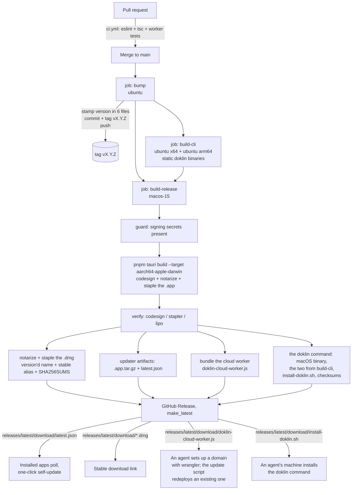

# Release pipeline — build, sign, notarize, publish

How a commit on `main` becomes a signed, notarized, downloadable app. Written
from Doklin's actual pipeline (`.github/workflows/release.yml`), but structured
so it can be lifted into any future Tauri desktop app — the per-app knobs are
collected in [Reusing this for a new app](#8-reusing-this-for-a-new-app).

**Scope: macOS, Apple Silicon.** That's what Doklin ships and what this pipeline
builds — the Rust backend has macOS-only call sites (grep `macOS-only`).

**Companion doc.** This is the *producer* half. What a running app does with
what CI publishes — the update manifest's semantics, the client state machine,
the Settings UI, the app-side plugin wiring — is
[docs/auto-update.md](auto-update.md), and this doc defers to it for all of it.

---

## 1. The shape of it



Two workflows, no more:

| Workflow | Trigger | Runner | Job |
| --- | --- | --- | --- |
| [`ci.yml`](../.github/workflows/ci.yml) | `pull_request` | `ubuntu-latest`, 10 min | `checks`: `pnpm lint` (eslint `react-hooks/rules-of-hooks`) + `pnpm exec tsc --noEmit`, then the cloud worker: its typecheck, `node cloud-worker/test/run.mjs`, the bundle (size printed, fails past 3 MB gzipped) and the suite again against the bundle. `cli`: builds the `doklin` command and drives it against the harness worker (`verify-harness/drive-cli.mjs`) |
| [`release.yml`](../.github/workflows/release.yml) | push to `main`, or `workflow_dispatch` | `ubuntu-latest` → `macos-15`, 360 min | `bump`, then `build-cli` (two Linux runners), then `build-release` |

The app's Rust is deliberately **not** built in the PR gate — it would
dominate CI time and the release build covers it. The `doklin` command is the
exception: it is a small crate of its own (`cli/`), nothing else builds it
before a release ships it, and its drive is the only automated check that
the command and the worker still agree. The PR gate exists for what a compile can't
catch: a hook-order bug shipped in v0.1.24 and made the app unbootable for four
releases, which is why eslint is a merge blocker.

**Every push to `main` cuts a release.** There is no manual "publish" step and
no release branch.

---

## 2. Storage: where the bits actually land

The "storage" for built artifacts is the **GitHub Release for the tag**, marked
`make_latest`. That gives permanently stable URLs under
`releases/latest/download/…`, which is what everything downstream points at —
no S3/R2 bucket, no CDN config, no credentials for consumers.

Every release carries eleven assets, staged in `release-assets/` (never `dist/` —
that's Vite's frontend output, and publishing `dist/*` would sweep `index.html`
and the web assets into the release; see commit `4d8f2e8`):

| Asset | Purpose | Consumer |
| --- | --- | --- |
| `Doklin-<version>-macos-arm64.dmg` | The versioned installer, notarized + stapled | Humans, archival |
| `Doklin-macos-arm64.dmg` | Byte-identical alias, copied **after** stapling | `releases/latest/download/…` — the stable download link (the README, a public page's footer) |
| `SHA256SUMS` | Checksums for both DMGs and the three `doklin` binaries | Verification; `install-doklin.sh` refuses a download that does not match |
| `Doklin.app.tar.gz` | The signed bundle the updater swaps in | `tauri-plugin-updater` |
| `latest.json` | Update manifest: version, notes, pub_date, per-platform `{signature, url}` | The updater endpoint in `tauri.conf.json` |
| `doklin-cloud-worker.js` | The cloud worker, bundled to one file (`scripts/bundle-worker.mjs`, the mermaid module spliced in) | `releases/latest/download/…` — what the app's setup prompt and the update script fetch |
| `doklin-cloud-update.sh` | `scripts/doklin-cloud-update.sh`, copied verbatim | `releases/latest/download/…` — the two commands on the app's "Update the worker" card curl and run it (docs/cloud.md §7.4) |
| `doklin-linux-x64` · `doklin-linux-arm64` · `doklin-macos-arm64` | The `doklin` command (`cli/`): what an agent uses to work with a workspace through its domain. The Linux two are static musl binaries | `install-doklin.sh` picks the one for the machine it runs on |
| `install-doklin.sh` | `scripts/install-doklin.sh`, copied verbatim | `releases/latest/download/…` — the line the app's agent login card hands out pipes it to `sh` (docs/cloud.md §8.6) |

Note the `.sig` file is **not** published: its contents are inlined into
`latest.json` as the `signature` field.

Because the alias names are version-less, anything that links to
`releases/latest/download/…` never needs updating per release. The flip side:
**renaming an alias breaks every deployed link until it's updated** (this bit
us when `Doklin-macos-universal.dmg` became `Doklin-macos-arm64.dmg`).

---

## 3. Job 1 — `bump`: version, commit, tag

Runs on `ubuntu-latest`. Owns versioning entirely; nothing is versioned by hand.

1. **Checkout `ref: main`** (the branch head, *not* the triggering SHA) with
   `fetch-depth: 0` so all tags are visible.
2. **Compute the next version.** Patch-bump the latest `v*` tag by default. If
   `src-tauri/tauri.conf.json` carries a version *higher* than the latest tag
   (compared with `sort -V`), that file version wins verbatim — that's how you
   cut a minor or major: raise it in your feature commit. First-ever release
   ships the committed version as-is. If the computed tag already exists, the
   job fails loudly rather than clobbering.
3. **Stamp the version into six places** — `package.json`,
   `src-tauri/tauri.conf.json`, and for each of the two crates its
   `Cargo.toml` and its own entry in its `Cargo.lock`: the app (`src-tauri/`,
   package `doklin`) and the command line (`cli/`, package `doklin-cli`). It
   uses `sed`/`awk` (first match only) rather than `jq` so JSON formatting
   stays untouched, then asserts all of them agree. `Cargo.lock` matters: a
   stale lock version makes the app's build dirty the lock and drift from the
   tag, and fails the command line's outright — it is built `--locked`.
4. **Commit `chore: release vX.Y.Z [skip ci]`, tag, push** both in one
   `git push origin HEAD:main refs/tags/vX.Y.Z`.

Two structural decisions worth carrying forward:

- **The release builds in the same run, not in a separate `on: push: tags`
  workflow.** GitHub never fires workflows from pushes made with `GITHUB_TOKEN`,
  so an on-tag workflow would simply never run. (The `[skip ci]` is
  belt-and-braces; the token rule is what actually prevents a bump loop.)
- **`concurrency: {group: release-main, cancel-in-progress: false}`** serializes
  runs. A second push during a release waits, then checks out the *just-bumped*
  head, so its bump lands on top and the push is never non-fast-forward.

Requires `permissions: contents: write` at the workflow level.

---

## 4. Job 2 — `build-release`: the macOS build

`runs-on: macos-15` — arm64 runner, Xcode 16.x.
`timeout-minutes: 360` is GitHub's hard per-job ceiling, chosen because Apple's
notarization queue is the one unbounded wait in the pipeline.

### 4.1 Fail fast on missing secrets

The very first step checks all eight secrets are non-empty and exits with
`::error::` listing what's missing. **There is no unsigned fallback** — a
missing secret must not silently produce a build that Gatekeeper rejects on
users' machines. Doing it before checkout means the failure costs seconds, not
the ~20 minutes a full build would.

### 4.2 Toolchain and caches

```
actions/checkout@v5           ref: <the tag from bump>   # the exact stamped commit
dtolnay/rust-toolchain@stable targets: aarch64-apple-darwin
Swatinem/rust-cache@v2        workspaces: src-tauri
pnpm/action-setup@v4          version: 10
actions/setup-node@v5         node-version: 22, cache: pnpm
pnpm install --frozen-lockfile
```

### 4.3 Build, sign, notarize — one command

```yaml
- run: pnpm tauri build --target aarch64-apple-darwin
  env:
    APPLE_CERTIFICATE:          ${{ secrets.MACOS_CERTIFICATE }}       # base64 .p12
    APPLE_CERTIFICATE_PASSWORD: ${{ secrets.MACOS_CERTIFICATE_PWD }}
    APPLE_SIGNING_IDENTITY:     ${{ secrets.MACOS_SIGNING_IDENTITY }}  # "Developer ID Application: … (TEAMID)"
    APPLE_ID:                   ${{ secrets.APPLE_ID }}
    APPLE_PASSWORD:             ${{ secrets.APPLE_PASSWORD }}          # app-specific password
    APPLE_TEAM_ID:              ${{ secrets.APPLE_TEAM_ID }}
    TAURI_SIGNING_PRIVATE_KEY:          ${{ secrets.TAURI_SIGNING_PRIVATE_KEY }}
    TAURI_SIGNING_PRIVATE_KEY_PASSWORD: ${{ secrets.TAURI_SIGNING_PRIVATE_KEY_PASSWORD }}
```

Tauri's bundler does the whole Apple story from those env vars, with no
keychain scripting on our side:

1. imports the `.p12` into an **ephemeral keychain** it creates and destroys
   (this is why no `KEYCHAIN_PWD` secret is needed);
2. `codesign`s the app and every nested binary with the **hardened runtime**;
3. `notarytool submit --wait` on the `.app`, using APPLE_ID / APPLE_PASSWORD /
   APPLE_TEAM_ID;
4. `stapler staple`s the ticket onto the `.app`;
5. builds and signs the `.dmg`;
6. because `createUpdaterArtifacts: true`, also produces `Doklin.app.tar.gz` and
   signs it with `TAURI_SIGNING_PRIVATE_KEY`, emitting a `.sig`.

`beforeBuildCommand: pnpm build` (= `tsc && vite build`) runs the frontend build
inside this same command.

### 4.4 Verify — don't trust, check

Tauri can silently skip notarization if an env var isn't recognized, and the
result looks like a successful build. So:

```sh
codesign --verify --deep --strict --verbose=2 "$APP"
xcrun stapler validate "$APP"
for bin in "$APP"/Contents/MacOS/*; do [ "$(lipo -archs "$bin")" = arm64 ] || fail; done
```

The `lipo` loop enforces the arm64-only invariant — an x86_64 slice
sneaking back would double build time unnoticed.

### 4.5 Notarize the DMG too

Tauri only notarizes the `.app`. A downloaded `.dmg` should also pass Gatekeeper
offline, so CI submits and staples the disk image itself:

```sh
mkdir -p release-assets
DMG="release-assets/Doklin-${VERSION}-macos-arm64.dmg"
cp src-tauri/target/aarch64-apple-darwin/release/bundle/dmg/*.dmg "$DMG"
xcrun notarytool submit "$DMG" --wait --apple-id … --password … --team-id …
xcrun stapler staple "$DMG"
cp "$DMG" release-assets/Doklin-macos-arm64.dmg     # alias AFTER stapling
(cd release-assets && shasum -a 256 *.dmg > SHA256SUMS)
```

Order matters: the alias is copied after stapling so both files carry the
ticket.

### 4.6 Updater manifest

The `.app.tar.gz` from the build is copied as-is, and CI hand-builds a
`latest.json` beside it: this run's version and a UTC `pub_date`, the `.sig`
file's contents inlined as `signature`, and a `url` pinned to **this tag** — the
manifest is fetched from a moving `latest` URL, but the payload it names is
immutable. Only `darwin-aarch64` is emitted.

The manifest's shape, its field-by-field semantics, and what an absent platform
key does to installs are in
[auto-update.md § Manifest format](auto-update.md#manifest-format-tauri-v2-static).

### 4.7 The cloud worker asset, and the update script

```yaml
- name: Bundle cloud worker (release asset)
  run: node scripts/bundle-worker.mjs release-assets/doklin-cloud-worker.js

- name: Stage the cloud update script (release asset)
  run: |
    cp scripts/doklin-cloud-update.sh release-assets/doklin-cloud-update.sh
    chmod +x release-assets/doklin-cloud-update.sh
```

`cloud-worker/src` (TypeScript) flattened by vite into one readable file with
the standalone mermaid module spliced in as a string — the same script CI
runs on every pull request, where it also prints the size and fails past
Cloudflare's 3 MB compressed ceiling. Staged beside the DMGs so the release
carries it under a stable name: the app's setup prompt points the agent at
`releases/latest/download/doklin-cloud-worker.js`, and nobody clones or
builds anything to deploy a domain.

The update script rides along verbatim. It fetches that same bundle and
carries its own copy of the worker's compatibility date, both pinned to
their sources by `verify-harness/cloudprompts.test.mjs`, so a release can
never publish a script that would deploy against the wrong runtime date.

### 4.8 The `doklin` command — three binaries and an installer

The command an agent uses to work with a workspace through its domain
(docs/cloud.md §8.6) ships as a release asset per platform, because a bot's
machine has no app to carry it and should need nothing installed first.

**`build-cli`**, a job of its own between `bump` and `build-release`, builds
the two Linux binaries — each natively, on a runner of its own architecture
(`ubuntu-latest` and `ubuntu-24.04-arm`):

```yaml
- run: sudo apt-get update && sudo apt-get install -y musl-tools
- uses: dtolnay/rust-toolchain@stable
  with:
    targets: ${{ matrix.target }}      # x86_64- / aarch64-unknown-linux-musl
- run: cargo build --release --locked --manifest-path cli/Cargo.toml --target "$TARGET"
```

Static musl, so one file runs on Debian, on Alpine and in a scratch
container. Native rather than cross-compiled because the TLS library carries
C and assembly, and a native `musl-gcc` (named outright in
`CC_<target>`, so nothing depends on a guess) is all that takes. The job
then checks what it built before handing it over: `readelf -d` must list no
`NEEDED` library, `doklin --version` must be `doklin <the release's
version>` — which is the stamp in `cli/Cargo.toml` and `cli/Cargo.lock`
agreeing with the tag — and `doklin help` must run. Each binary is passed on
as a workflow artifact.

`build-release` **needs** `build-cli`, rather than merely following it: the
two binaries are release assets, and a release without them would break the
installer for everyone at once. It builds the macOS binary itself, after the
app (`lipo` must say `arm64`, `codesign --verify` must pass, the version must
match), downloads the two artifacts, copies `scripts/install-doklin.sh` in
verbatim and appends the three binaries to `SHA256SUMS`.

Two things this deliberately does not do:

- **The macOS binary is not notarized.** It carries the linker's ad-hoc
  signature, which is all an Apple Silicon Mac needs to run a file that
  `curl` fetched — there is no quarantine flag on it. Notarizing would be a
  third Apple round-trip per release (§7's unbounded wait, again) for a
  browser download nobody is pointed at.
- **Nothing is installed by a package manager.** The installer is forty
  lines of POSIX `sh`: pick the asset for `uname`, fetch it and
  `SHA256SUMS`, compare, and rename it into `$DOKLIN_INSTALL_DIR`,
  `/usr/local/bin` or `~/.local/bin`. `verify-harness/cloudprompts.test.mjs`
  runs it against a release made up in a temp folder — every platform,
  a checksum that does not match, a binary the release does not carry — and
  holds its URL, the line the app hands out and the asset names in this
  workflow to each other.

### 4.9 Publish

```yaml
uses: softprops/action-gh-release@v2
with:
  tag_name: ${{ needs.bump.outputs.tag }}
  files: release-assets/*
  make_latest: 'true'
  generate_release_notes: true
  fail_on_unmatched_files: true
```

`fail_on_unmatched_files` turns a staging mistake into a red build instead of a
half-empty release.

---

## 5. Handing off to the updater

The pipeline's responsibility ends at three outputs of the publish step: the
signed `Doklin.app.tar.gz`, the `latest.json` beside it (§4.6), and
`make_latest: 'true'` on the release. What each one buys on the client side is
[auto-update.md § What the release pipeline has to hand it](auto-update.md#what-the-release-pipeline-has-to-hand-it).

One invariant no step here can check for you: the `TAURI_SIGNING_PRIVATE_KEY`
secret must be the private half of the `plugins.updater.pubkey` compiled into
the shipped app. Mismatch them and every build stays green while every installed
app silently refuses the update.

Everything past that boundary — the client state machine, the Settings UI, the
app-side plugin and capability wiring, the security model, and a portable
checklist for adding one-click updates to another Tauri app — is
[auto-update.md](auto-update.md).

---

## 6. Secrets

Eight repository secrets. **Six are Apple account/team-level, not per-app** —
the same values are reused verbatim across every app on the same Apple
Developer account, so a new repo just copies them:

| Secret | What it is | Scope |
| --- | --- | --- |
| `MACOS_CERTIFICATE` | Developer ID Application `.p12`, base64-encoded (`base64 -i cert.p12 \| pbcopy`) | Team |
| `MACOS_CERTIFICATE_PWD` | Export password for that `.p12` | Team |
| `MACOS_SIGNING_IDENTITY` | `Developer ID Application: Name (TEAMID)` | Team |
| `APPLE_ID` | Apple Developer account email | Team |
| `APPLE_PASSWORD` | App-specific password (per *tool*, i.e. notarytool — not per product) | Team |
| `APPLE_TEAM_ID` | 10-char team ID | Team |
| `TAURI_SIGNING_PRIVATE_KEY` | minisign private key from `tauri signer generate` | **Per app** |
| `TAURI_SIGNING_PRIVATE_KEY_PASSWORD` | its password | **Per app** |

The only per-app Apple-side item is the bundle identifier in `tauri.conf.json`.
Developer ID distribution requires **no Apple-side app registration** — no App
Store Connect record, no provisioning profile.

**Notarization latency:** the account's first-ever submission took ~3 days while
Apple warmed up to the account; every submission since returns in seconds to
minutes. That warm-up is per developer *account*, not per app — a new app on an
established account notarizes fast from day one. No CI timeout covers a
multi-day hold (6h ceiling); recovery is re-running the failed job.

---

## 7. Failure playbook

| Symptom | Cause | Fix |
| --- | --- | --- |
| `missing signing secrets: …` in the first step | Secret not set on this repo | Copy the six Apple values from a sibling repo; generate a fresh updater keypair |
| Job times out at 6h in notarization | Apple holding the submission | **Re-run failed jobs** — reuses `bump`'s tag and just resubmits. Never re-push. |
| `tag vX.Y.Z already exists` | Aborted earlier run left the tag | Delete the tag, or raise the version in `tauri.conf.json` |
| `stapler validate` fails but build was green | Tauri skipped notarization (unrecognized env var) | Check env var names — Tauri wants `APPLE_CERTIFICATE`, not `MACOS_CERTIFICATE` |
| Release contains `index.html` and JS assets | Something staged into `dist/` | Stage only into `release-assets/` |
| Users see "app is damaged" / Gatekeeper prompt | Unsigned or unstapled artifact | Verify locally: `spctl -a -vvv -t install Doklin.app` |
| A download link 404s | Alias filename changed | Fix every link that hardcodes the alias |
| `build-cli` fails at `cargo build --locked` | `cli/Cargo.lock` does not match `cli/Cargo.toml` — a dependency changed without the lock being committed, or the version stamp missed the lock | Run `cargo build --manifest-path cli/Cargo.toml` locally and commit the lock; for the stamp, check the `doklin-cli` entry is still `name` then `version` on consecutive lines |
| `install-doklin.sh` says the download does not match its checksum | A release was published between its two downloads, or an asset was replaced by hand | Run it again; never re-upload a binary without regenerating `SHA256SUMS` |

Build, signing and publishing symptoms only. When the release itself looks
correct but installed apps don't take it, the causes are client-side and are
tabulated in
[auto-update.md § Gotchas](auto-update.md#gotchas-paid-for-the-hard-way).

---

## 8. Reusing this for a new app

Copy `.github/workflows/release.yml` and `ci.yml` verbatim, then change:

**Repo settings**
- [ ] Add the six Apple secrets (same values, same names, copied from any sibling app).
- [ ] `pnpm tauri signer generate -w ~/.tauri/<app>.key` → add
      `TAURI_SIGNING_PRIVATE_KEY` + `…_PASSWORD` secrets, put the **public** key
      in `tauri.conf.json`.
- [ ] Workflow needs `permissions: contents: write`.

**`src-tauri/tauri.conf.json`**
- [ ] `productName`, `version`, `identifier` (`com.<you>.<app>`)
- [ ] `bundle.createUpdaterArtifacts: true`, `bundle.targets: "all"`
- [ ] `bundle.macOS.minimumSystemVersion` (+ an `entitlements` path if the app needs any)
- [ ] `bundle.icon` list, `fileAssociations` if the app owns a file type
- [ ] `externalBin` / `resources` only if you ship sidecars

**`release.yml` edits**
- [ ] `Cargo.lock` stamp: the `awk` matches `name = "doklin"` — change the crate name
- [ ] All `Doklin.app` / `Doklin-macos-arm64.dmg` / `Doklin.app.tar.gz` names
- [ ] The `.app` path (`target/<triple>/release/bundle/…`)
- [ ] A sidecar or helper binary must be built and staged as a step before
      `tauri build` (it fails fast on a missing `externalBin`), and is signed
      as part of the app — so its entitlements matter
- [ ] Keep: secret guard, `codesign --verify`, `stapler validate`, `lipo` arch
      check, DMG notarize+staple, alias copy, `SHA256SUMS`, `latest.json`

**App code**
- [ ] The updater client is its own checklist — plugins, capabilities, `lib.rs`
      registration, `plugins.updater` pubkey + endpoint, and the Settings UI:
      [auto-update.md § Porting checklist](auto-update.md#part-3--porting-checklist-for-a-new-app)

**Sanity check before the first push to main:** run `pnpm tauri build` locally
unsigned, confirm the bundle paths in the workflow match what you get, then let
CI do the first signed run.
